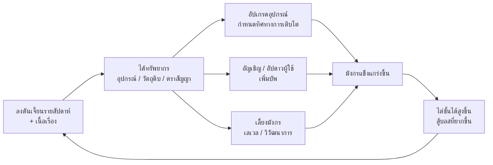

# Path to Dragon — Game Design Document (GDD)

> เวอร์ชันเอกสาร: 0.1 (ร่างแรก) · แพลตฟอร์ม: iOS / Android / แท็บเล็ต (จอแนวตั้ง) · เอนจิน: Unity 6 LTS

เอกสารที่เกี่ยวข้อง:
- [UI-Portrait.md](UI-Portrait.md) — การออกแบบหน้าจอแนวตั้งและ wireframe
- [Balance.md](Balance.md) — สูตรคำนวณ ตารางค่าพลัง และเศรษฐกิจในเกม
- [Unity-Tech.md](Unity-Tech.md) — สถาปัตยกรรมและแนวทางพัฒนาบน Unity
- [balance-report.md](balance-report.md) — ผลจำลองสมดุลล่าสุด

---

## สารบัญ

1. [ภาพรวมเกม](#1-ภาพรวมเกม)
2. [Core Loop](#2-core-loop)
3. [ระบบมังกร](#3-ระบบมังกร-dragon)
4. [ระบบอุปกรณ์และทิศทางการเติบโต](#4-ระบบอุปกรณ์และทิศทางการเติบโต-equipment--growth-path)
5. [ระบบผู้ใช้มังกร (Rider)](#5-ระบบผู้ใช้มังกร-rider)
6. [ดันเจี้ยนรายสัปดาห์](#6-ดันเจี้ยนรายสัปดาห์-weekly-dungeon)
7. [ระบบต่อสู้](#7-ระบบต่อสู้-combat)
8. [โหมดเกมอื่น ๆ](#8-โหมดเกมอื่น-ๆ)
9. [ทรัพยากรและเศรษฐกิจ](#9-ทรัพยากรและเศรษฐกิจ)
10. [Monetization](#10-monetization)
11. [การปลดล็อกฟีเจอร์และ Onboarding](#11-การปลดล็อกฟีเจอร์และ-onboarding)
12. [Roadmap การพัฒนา](#12-roadmap-การพัฒนา)
13. [คำถามที่ยังต้องตัดสินใจ](#13-คำถามที่ยังต้องตัดสินใจ)

---

## 1. ภาพรวมเกม

### 1.1 Elevator Pitch

> **"มังกรคือมรดก ผู้ใช้คือผู้สืบทอด"**
>
> เลี้ยงมังกรหนึ่งตัวตั้งแต่ฟักจากไข่จนกลายเป็นมังกรโบราณ กำหนดว่ามันจะเติบโตเป็นมังกรแบบไหนผ่านอุปกรณ์ที่สวมใส่
> แล้วเลือกผู้ใช้มังกร (Rider) ที่จะขึ้นขี่และเสริมพลังให้มัน บุกดันเจี้ยนที่เปลี่ยนทุกสัปดาห์เพื่อหาวัตถุดิบมาทำให้มังกรแข็งแกร่งขึ้นไปเรื่อย ๆ

### 1.2 ข้อมูลพื้นฐาน

| หัวข้อ | รายละเอียด |
|---|---|
| ชื่อเกม | Path to Dragon (P2D) |
| แนวเกม | Dragon-raising RPG / Collection + Progression, ต่อสู้แบบ semi-auto |
| มุมมอง | 3D low-poly สไตล์การ์ตูน กล้องมองเฉียงลงจากด้านบน (ตัดสินใจแล้ว) |
| การวางจอ | **แนวตั้ง (Portrait) เท่านั้น** เล่นมือเดียวได้ |
| กลุ่มเป้าหมาย | ผู้เล่นมือถือ 16–35 ปี ชอบเกมสะสม/อัปเกรด เล่นวันละ 15–30 นาที |
| ความยาว session | 3–10 นาที (เคลียร์ชั้นดันเจี้ยน / อัปเกรด / เก็บของ) |
| โมเดลธุรกิจ | Free-to-Play + Battle Pass + Cosmetic + Summon (มีระบบการันตี) |

### 1.3 เสาหลักของการออกแบบ (Design Pillars)

1. **มังกรตัวเดียว ผูกพันระยะยาว** — ทุกการลงทุนไหลไปที่มังกรตัวเดียว ผู้เล่นเห็นมังกรโตขึ้นจริงทั้งขนาด รูปร่าง และพลัง
2. **ผู้เล่นเป็นผู้กำหนดทิศทาง** — ไม่มีคลาสตายตัว อุปกรณ์คือสิ่งที่กำหนดว่ามังกรจะเป็นสายโจมตี ป้องกัน ความเร็ว หรือเวทมนตร์ และเปลี่ยนใจได้โดยไม่เสียของที่ลงทุนไป
3. **ผู้ใช้คือตัวเสริม ไม่ใช่ตัวหลัก** — ผู้เล่นสวมบทผู้ใช้มังกรที่สลับตัวได้ตลอด ผู้ใช้ระดับสูงและดาวสูงให้บัพมังกรมากขึ้น
4. **ทุกสัปดาห์มีเหตุผลให้กลับมา** — ดันเจี้ยนรายสัปดาห์เปลี่ยนธีม บอส และเงื่อนไข ทำให้ต้องปรับชุดอุปกรณ์และผู้ใช้ใหม่
5. **มือเดียว แนวตั้ง** — ทุกปุ่มสำคัญอยู่ในระยะนิ้วโป้ง

### 1.4 โลกและเรื่องราว (ย่อ)

ทวีป **เอเธเรีย (Aetheria)** เคยถูกปกครองโดยเหล่ามังกรโบราณ จนกระทั่งมังกรสูญพันธุ์ไปเมื่อพันปีก่อน
ผู้เล่นเป็นสมาชิกของ **ภาคีผู้ทำสัญญา (Order of the Pact)** ที่ค้นพบไข่มังกรใบสุดท้าย
มังกรจะมีชีวิตยืนยาวกว่ามนุษย์หลายเท่า จึงต้องมี "ผู้ใช้" หลายคนสืบทอดสัญญากันไป — นี่คือเหตุผลในเรื่องที่ผู้เล่นเปลี่ยนตัวผู้ใช้ได้ตลอด

"เส้นทางมังกร (Path to Dragon)" คือการเดินทางของมังกรจากไข่สู่มังกรโบราณ และการค้นหาความจริงว่าทำไมมังกรถึงหายไป

---

## 2. Core Loop



### 2.1 ลูปตามช่วงเวลา

| ช่วง | สิ่งที่ผู้เล่นทำ | เป้าหมาย |
|---|---|---|
| **ต่อ session (3–10 นาที)** | ไต่ชั้นดันเจี้ยน 1–3 ชั้น, กวาดชั้นที่เคลียร์แล้ว, เก็บรายได้จากรัง, อัปเกรดอุปกรณ์ 1–2 ชิ้น | รู้สึกว่ามังกรแรงขึ้นทุกครั้งที่เข้าเกม |
| **รายวัน** | ใช้คบเพลิงวิญญาณ (กุญแจ) ให้หมด, ทำภารกิจรายวัน, อัญเชิญฟรี 1 ครั้ง | สะสมวัตถุดิบ |
| **รายสัปดาห์** | ไต่ให้ถึงชั้นสูงสุดก่อนรีเซ็ต, ล้มบอสประจำสัปดาห์, เปิดหีบรางวัลสัปดาห์ | ได้วัตถุดิบวิวัฒนาการ + ชุดอุปกรณ์ประจำธีม |
| **รายเดือน / ซีซัน** | Battle Pass, ผู้ใช้ใหม่, ดันเจี้ยนพิเศษธาตุแสง/มืด | เป้าหมายระยะยาว & คอลเลกชัน |
| **ระยะยาว** | วิวัฒนาการมังกรจนถึงร่างโบราณ, ปั้นอุปกรณ์หลายเซ็ตสำหรับแต่ละ Path | ความผูกพันกับมังกร |

---

## 3. ระบบมังกร (Dragon)

### 3.1 แนวคิด

- ผู้เล่นมี **มังกรหลัก 1 ตัว** ตลอดทั้งเกม (สกินและรูปร่างเปลี่ยนตามระยะและ Path)
- มังกรมีค่าพลังพื้นฐานจาก **เลเวล** และ **ระยะวิวัฒนาการ (Stage)**
- อุปกรณ์และผู้ใช้เป็นตัวคูณ/ตัวกำหนดทิศทาง

### 3.2 ระยะวิวัฒนาการ (Evolution Stage)

| Stage | ชื่อ | ช่วงเลเวล | ช่องอุปกรณ์ที่ปลดล็อก | ช่องสกิล | ตัวคูณค่าพลัง |
|---|---|---|---|---|---|
| 0 | ไข่มังกร (Egg) | — (บทสอน) | — | — | — |
| 1 | ลูกมังกร (Hatchling) | 1–20 | แก่นหัวใจ, กรงเล็บ, เกราะอก | 1 | ×1.00 |
| 2 | มังกรเยาว์ (Drake) | 21–40 | + เขา | 2 | ×1.15 |
| 3 | มังกรหนุ่ม (Wyrm) | 41–60 | + ปีก | 3 | ×1.35 |
| 4 | มังกรโตเต็มวัย (Elder) | 61–80 | + หาง | 3 + ช่องผู้ใช้สนับสนุน 2 ช่อง | ×1.60 |
| 5 | มังกรโบราณ (Ancient) | 81–100 | ปลุกพลังแก่นหัวใจ (Heart Awakening) | 3 + สกิลขั้นสุด Path | ×2.00 |

- เมื่อถึงเลเวลสูงสุดของ Stage ต้อง **วิวัฒนาการ (Evolve)** โดยใช้ **เกล็ดโบราณ** (ได้จากบอสดันเจี้ยนรายสัปดาห์เป็นหลัก) — นี่คือ "ประตู" ที่ผูกความคืบหน้าระยะยาวกับดันเจี้ยนรายสัปดาห์
- การวิวัฒนาการมีฉากคัตซีนสั้น ๆ (5–8 วินาที, ข้ามได้) ให้ผู้เล่นรู้สึกถึงรางวัลใหญ่

### 3.3 การเพิ่มเลเวล

- ป้อน **แก่นมังกร (Dragon Essence)** + ทอง → ได้ EXP
- แหล่ง Essence: รังมังกร (idle), เนื้อเรื่อง, กวาดชั้นดันเจี้ยน
- สูตรค่าพลัง/EXP ดูที่ [Balance.md §1](Balance.md#1-ค่าพลังมังกร)

### 3.4 ค่าพลัง (Stats)

| ค่าพลัง | ความหมาย |
|---|---|
| HP | พลังชีวิต |
| ATK | พลังโจมตี |
| DEF | พลังป้องกัน ลดความเสียหายที่ได้รับ |
| SPD | ความเร็ว — กำหนดความถี่การโจมตีปกติ และโอกาสหลบ |
| CRIT Rate / CRIT DMG | โอกาสคริติคอล / ตัวคูณคริติคอล |
| Element DMG% | เพิ่มความเสียหายธาตุ (ธาตุลมหายใจมาจากแก่นหัวใจ) |
| Skill Haste | ลดคูลดาวน์สกิล |
| Resist | ลดโอกาสติดสถานะผิดปกติ |

### 3.5 ธาตุ (Element)

วงจรธาตุ: **ไฟ → ลม → ดิน → น้ำ → ไฟ** (ลูกศรชี้ไปยังธาตุที่ชนะ) และ **แสง ⇄ มืด** ชนะกันและกัน

- ธาตุของมังกร (ธาตุลมหายใจ / Breath) ถูกกำหนดโดย **อุปกรณ์ช่องแก่นหัวใจ (Heart Core)** → เปลี่ยนธาตุได้ด้วยการเปลี่ยนแก่นหัวใจ
- ได้เปรียบธาตุ ×1.3 / เสียเปรียบ ×0.8
- แสง/มืดเปิดใน Phase หลัง (ดันเจี้ยนพิเศษรายเดือน)

### 3.6 รูปลักษณ์ที่เปลี่ยนตามการเติบโต

- **Stage** เปลี่ยนขนาดและโครงร่าง (ลูกมังกรตัวเล็ก ปีกสั้น → มังกรโบราณเต็มจอ)
- **Path ที่โดดเด่น (Dominant Path)** เปลี่ยนรายละเอียด เช่น
  - เพลิงโทสะ: เขาแหลม เกล็ดแดงเรืองแสง
  - ศิลาปราการ: เกล็ดหนาเหมือนหิน ตัวใหญ่
  - วายุ: ลำตัวเพรียว ปีกยาว
  - มนตรา: ลายรูนเรืองแสง หางเป็นผลึก
- **ธาตุ** เปลี่ยนสีเอฟเฟกต์ลมหายใจและออร่า
- รวม 5 Stage × 4 Path = 20 รูปลักษณ์หลัก (ทำด้วยระบบ skin/part swap เพื่อลดงานอาร์ต — ดู [Unity-Tech.md](Unity-Tech.md#6-งานอาร์ตมังกรแบบ-modular))

---

## 4. ระบบอุปกรณ์และทิศทางการเติบโต (Equipment & Growth Path)

### 4.1 แนวคิดหลัก

อุปกรณ์ทุกชิ้นมี **Path** ติดตัว 1 แบบ ค่า **Affinity** ของแต่ละ Path รวมจากอุปกรณ์ที่สวมอยู่ + ผู้ใช้
Path ที่มี Affinity สูงจะปลดล็อก **คุณสมบัติติดตัว (Path Trait)** และ **สกิล** — ผู้เล่นจึง "กำหนดทิศทางการเติบโต" ของมังกรผ่านการเลือกและอัปเกรดอุปกรณ์

### 4.2 Growth Path ทั้ง 4

| Path | ไอคอน | เน้น | ตัวอย่าง Trait |
|---|---|---|---|
| **เพลิงโทสะ (Fury)** | 🔥 | ATK, CRIT | I: ATK +5% · II: คริติคอลทำให้ศัตรูติดไฟ 20% ATK/วินาที 3 วินาที · III: ยิ่ง HP ศัตรูต่ำยิ่งแรง สูงสุด +20% · IV: สกิลขั้นสุด "อัคคีวินาศ" |
| **ศิลาปราการ (Bastion)** | 🛡️ | HP, DEF, โล่ | I: HP +6% · II: เริ่มการต่อสู้ด้วยโล่ 10% HP และโจมตีปกติแรงขึ้นตาม HP · III: สะท้อนดาเมจที่ได้รับ 20% · IV: สกิลขั้นสุด "ป้อมปราการนิรันดร์" |
| **วายุ (Tempest)** | 🌪️ | SPD, หลบ, โจมตีหลายครั้ง | I: SPD +8 · II: โอกาสหลบ +8% · III: ทุกการโจมตีครั้งที่ 4 โจมตีซ้ำ · IV: สกิลขั้นสุด "พายุพันปีก" |
| **มนตรา (Arcane)** | ✨ | Element DMG, คูลดาวน์ | I: Element DMG +6% · II: Skill Haste +10 · III: ใช้สกิลครบ 3 ครั้ง สกิลถัดไปไม่ติดคูลดาวน์ (สะท้อนรูน) · IV: สกิลขั้นสุด "ฝนดาราจักร" |

**เกณฑ์ Affinity:** Tier I = 20 · Tier II = 60 · Tier III = 120 · Tier IV = 200 (สูตรละเอียดที่ [Balance.md §3](Balance.md#3-affinity-และ-path))

**Path Resonance (เส้นทางคู่):** ทุกคู่ของ Path ที่ Affinity ≥ 60 พร้อมกัน (UR ออรีออน: ≥ 40) ได้โบนัสผสม — ให้ผู้เล่นเลือกได้ระหว่าง "สุดทางเดียว" กับ "ไฮบริด"

| คู่ | ชื่อ | ผล |
|---|---|---|
| เพลิง + วายุ | เพลิงพายุ | สกิลหลายฮิตและการโจมตีซ้ำมีโอกาสคริติคอล +15% |
| เพลิง + ปราการ | เกราะโลหิต | ดูดเลือด 5% ของดาเมจที่ทำ |
| เพลิง + มนตรา | เปลวรูน | ดาเมจติดไฟ +50% |
| ปราการ + วายุ | กำแพงลม | หลบสำเร็จได้โล่ 3% HP (5 วินาที) |
| ปราการ + มนตรา | ม่านรูน | โล่ทุกชนิดเพิ่มตาม Element DMG |
| วายุ + มนตรา | ดาราวายุ | Skill Haste +10 และหลบสำเร็จลดคูลดาวน์สกิล 1 วินาที |

**สกิลมังกร:** แต่ละ Path มีสกิล 4 สกิล ปลดล็อกตาม Tier ของ Path นั้น (Tier IV = สกิลขั้นสุด) ผู้เล่นใส่ได้ตามจำนวนช่องที่ Stage ปลดล็อก (1 / 2 / 3 ช่อง) ผสมจากหลาย Path ได้ แต่ **ใส่สกิลขั้นสุดได้ครั้งละ 1 สกิล**

| Path | Tier I | Tier II | Tier III | Tier IV (ขั้นสุด) |
|---|---|---|---|---|
| 🔥 เพลิงโทสะ | **กรงเล็บอัคคี** — โจมตีเดี่ยว 200% | **ลมหายใจแผดเผา** — โจมตีทั้งหมด 100% + ติดไฟ 30% ATK/วินาที 4 วินาที | **ขย้ำปลิดชีพ** — โจมตีเดี่ยว 250% ดาเมจ ×2 ถ้าเป้า HP < 30% | **อัคคีวินาศ** — โจมตีทั้งหมด 400% + ติดไฟ 50% ATK/วินาที 5 วินาที |
| 🛡️ ศิลาปราการ | **เกล็ดกำบัง** — โล่ 15% HP 6 วินาที | **หางพิฆาต** — โจมตีเดี่ยว 160% + 12% HP สูงสุด + โล่ 8% HP | **ฟื้นฟูศิลา** — ฟื้น HP 20% | **ป้อมปราการนิรันดร์** — โจมตีทั้งหมด + โล่ 40% HP + สะท้อนดาเมจ 30% นาน 10 วินาที |
| 🌪️ วายุ | **กรงเล็บสายลม** — โจมตีเดี่ยว 70% × 4 ฮิต | **ก้าวลมหมุน** — โอกาสหลบ +25% 5 วินาที | **ลมตัด** — โจมตีทั้งหมด 60% × 3 ฮิต | **พายุพันปีก** — 80% × 12 ฮิต (ย้ายเป้าเมื่อศัตรูตาย) |
| ✨ มนตรา | **ลูกแก้วรูน** — โจมตีเดี่ยว 180% Element DMG +20% | **สายฟ้าดารา** — โจมตีทั้งหมด 110% | **กระจกเวลา** — ลดคูลดาวน์สกิลอื่น 4 วินาที | **ฝนดาราจักร** — โจมตีทั้งหมด 120% × 3 ฮิต Element DMG +50% |

คูลดาวน์และตัวเลขทั้งหมดที่ [Balance.md §10](Balance.md#10-สกิลและ-trait-ของ-path)

### 4.3 ช่องอุปกรณ์ (6 ช่อง)

| ช่อง | Main Stat | หมายเหตุ |
|---|---|---|
| แก่นหัวใจ (Heart Core) | Element DMG% / ATK% / HP% | **กำหนดธาตุลมหายใจ** |
| กรงเล็บ (Claw) | ATK (flat) | |
| เกราะอก (Chest Plate) | HP (flat) | |
| เขา (Horn) | สุ่ม: ATK% / HP% / DEF% / CRIT Rate / CRIT DMG | ปลดล็อก Stage 2 |
| ปีก (Wing) | สุ่ม: SPD / ATK% / HP% / DEF% | ปลดล็อก Stage 3 |
| หาง (Tail) | DEF (flat) / Resist | ปลดล็อก Stage 4 |

### 4.4 ความหายาก (Rarity)

| ระดับ | สี | Sub-stat เริ่มต้น | Affinity พื้นฐาน | แหล่งที่มา |
|---|---|---|---|---|
| ธรรมดา (Common) | ขาว | 0 | 4 | เนื้อเรื่องช่วงต้น |
| ดี (Uncommon) | เขียว | 1 | 6 | เนื้อเรื่อง, ดันเจี้ยนชั้นต้น |
| หายาก (Rare) | ฟ้า | 2 | 9 | ดันเจี้ยน |
| มหากาพย์ (Epic) | ม่วง | 3 | 13 | ดันเจี้ยนชั้นกลาง, บอส |
| ตำนาน (Legendary) | ส้ม | 4 | 18 | บอสรายสัปดาห์, หีบรายสัปดาห์ |
| เทพนิยาย (Mythic) | แดง | 4 + เอฟเฟกต์เฉพาะ | 25 | บอสรายสัปดาห์ (โอกาสต่ำ), การหลอมรวม |

> นอกจากสี ทุกระดับต้องมีกรอบ/ไอคอนต่างกันเพื่อผู้เล่นที่ตาบอดสี

### 4.5 การอัปเกรดอุปกรณ์

| ระบบ | รายละเอียด | ทรัพยากร |
|---|---|---|
| **ตีบวก (Enhance)** | +0 → +15 สำเร็จ 100% (ไม่มีการแตก/ลดระดับ) Main stat และ Affinity เพิ่มทุกขั้น ที่ +3/+6/+9/+12/+15 ได้ sub-stat ใหม่หรืออัปค่า sub-stat เดิม | ศิลาตีเหล็ก + ทอง |
| **หลอมทิศทาง (Path Reforge)** | เปลี่ยน Path ของอุปกรณ์ **โดยคงระดับตีบวกไว้** — หัวใจของการ "เปลี่ยนทิศทางโดยไม่เสียการลงทุน" | ผลึกธาตุ + แก่น Path |
| **ขัดเกลา (Refine)** | สุ่ม sub-stat ใหม่ 1 ค่า (ล็อกค่าที่ชอบได้) | หินขัดเกลา |
| **ทะลุขีด (Ascend)** | อัปความหายาก เช่น ตำนาน → เทพนิยาย ใช้อุปกรณ์ซ้ำ + เกล็ดโบราณ | เกล็ดโบราณ + อุปกรณ์วัตถุดิบ |
| **ย่อยสลาย (Salvage)** | แยกอุปกรณ์ที่ไม่ใช้ คืนศิลาตีเหล็ก 80% ของที่ลงไป | — |

### 4.6 ชุดอุปกรณ์ (Set Bonus)

แต่ละธีมของดันเจี้ยนรายสัปดาห์ดรอปชุดเฉพาะ — ทำให้ผู้เล่นมีเหตุผลกลับมาทุกสัปดาห์

| ชุด | ดรอปจากธีม | 2 ชิ้น | 4 ชิ้น |
|---|---|---|---|
| เกล็ดลาวา (Magma Scale) | ภูเขาไฟคำราม | ATK +12% | คริติคอลทำให้เกิดการระเบิดเพลิง 60% ATK |
| หนามธารน้ำแข็ง (Glacial Thorn) | ธารน้ำแข็งนิรันดร์ | DEF +15% | ขณะมีโล่ สะท้อนความเสียหาย 20% |
| ขนนกพายุ (Storm Plume) | ยอดเขาอัสนี | SPD +12 | หลบสำเร็จ → โจมตีสวนทันที |
| ดาราโบราณ (Ancient Star) | ป่าศิลาดวงดาว | Skill Haste +8 | หลังใช้สกิล Element DMG +25% 5 วินาที |

### 4.7 Loadout Preset

บันทึก **อุปกรณ์ + สกิล + ผู้ใช้** เป็นชุดได้ 3 ชุด (ขยายเป็น 5 ชุดผ่าน Battle Pass / ความคืบหน้า) สลับได้ด้วยการแตะครั้งเดียว — สำคัญมากเพราะบอสแต่ละสัปดาห์ต้องการ Path ต่างกัน

---

## 5. ระบบผู้ใช้มังกร (Rider)

### 5.1 แนวคิด

- ผู้เล่น **คือผู้ใช้มังกร** — ตัวละครที่ขี่มังกรอยู่คืออวาตาร์ของผู้เล่น และ **เปลี่ยนตัวได้ตลอดเวลา** (นอกการต่อสู้)
- ผู้ใช้ไม่ได้ต่อสู้เอง แต่ให้ **บัพสัญญา (Pact Buff)** กับมังกร + **Affinity** ให้ Path ของตน + (ระดับสูง) **สกิลบัญชาการ (Command Skill)**
- **ผู้ใช้ระดับสูง = บัพมากและหลากหลายกว่า** และบัพเพิ่มขึ้นตาม **ระดับดาว**
- อัปดาวด้วยการนำ **ผู้ใช้ตัวเดียวกัน (ตัวซ้ำ)** มาใส่

### 5.2 ระดับของผู้ใช้ (Rider Rank)

| ระดับ | ชื่อ | Pact Buff | Affinity | Command Skill | พิเศษ |
|---|---|---|---|---|---|
| R | ผู้ฝึกหัด (Apprentice) | 1 ค่า | — | — | — |
| SR | อัศวินมังกร (Dragon Knight) | 1 ค่า | ✔ | — | — |
| SSR | จ้าวมังกร (Dragon Lord) | 2 ค่า | ✔ | ✔ | — |
| UR | ตำนาน (Legend) | 3 ค่า (มีเอฟเฟกต์พิเศษ) | ✔ (สูง) | ✔ | **Legacy Trait** เปลี่ยนกติกาการเล่น |

### 5.3 ระดับดาว (Star) — 1★ ถึง 5★

| ดาว | ตัวคูณบัพ | ใช้ตัวซ้ำ (ต่อขั้น) | ปลดล็อกเพิ่ม |
|---|---|---|---|
| 1★ | ×1.00 | — (ได้รับครั้งแรก) | Pact Buff พื้นฐาน |
| 2★ | ×1.25 | 1 | — |
| 3★ | ×1.50 | 2 | **Star Trait** (บัพเสริม 1 ค่า) |
| 4★ | ×1.80 | 3 | — |
| 5★ | ×2.20 | 4 | **ปลุกพลัง (Awaken)**: Command Skill อัปเกรด + กรอบ/เอฟเฟกต์ใหม่ |

- รวมต้องใช้ตัวซ้ำ 10 ตัวจาก 1★ → 5★
- **ผนึกวิญญาณสากล (Universal Soul Seal)** ของแต่ละระดับ แทนตัวซ้ำได้สูงสุด 50% ของแต่ละขั้น (ปัดลง) — ลดความหงุดหงิดจากการสุ่ม
- ได้ตัวซ้ำเมื่อ 5★ แล้ว → แปลงเป็น **เศษวิญญาณผู้ใช้** (R 5 / SR 20 / SSR 100 / UR 300) ใช้แลกในร้านเศษวิญญาณ

### 5.4 ตัวอย่างผู้ใช้ (ชุดเปิดตัว)

| ผู้ใช้ | ระดับ | Path | Pact Buff (ที่ 1★ → 5★) | Command Skill / พิเศษ |
|---|---|---|---|---|
| **ทิม** เด็กเลี้ยงมังกร | R | — | HP +4% → +8.8% | — |
| **มีน่า** นักธนูหมู่บ้าน | R | — | ATK +4% → +8.8% | — |
| **ลีร่า** ปีกวายุ | SR | วายุ | SPD +5 → +11, Affinity วายุ +6 → +13 | — |
| **กอร์ธ** ช่างตีเกล็ด | SR | ปราการ | DEF +6% → +13.2%, Affinity ปราการ +6 → +13 | — |
| **ไคเรน** ดาบเพลิง | SSR | เพลิงโทสะ | ATK +10% → +22%, CRIT DMG +15% → +33%, Affinity +12 → +26 | **"คำสั่งเผาผลาญ"** มังกรโจมตีแรงขึ้น 50% 6 วินาที |
| **เซเลน่า** ม่านจันทรา | SSR | มนตรา | Element DMG +10% → +22%, Skill Haste +6 → +13, Affinity +12 → +26 | **"รูนสะท้อนจันทร์"** รีเซ็ตคูลดาวน์สกิลมังกร 1 สกิล |
| **โบรกัน** กำแพงเหล็ก | SSR | ปราการ | HP +10% → +22%, DEF +10% → +22%, Affinity +12 → +26 | **"ยืนหยัด"** โล่ 25% HP 8 วินาที |
| **ฟินน์** นักตามรอย | SR | วายุ | SPD +4 → +8, Affinity วายุ +6 → +13, **นักล่า** +10% → +22% | — |
| **ซีเฟอร์** ฝ่าพายุ | SSR | วายุ | SPD +7 → +15, CRIT Rate +8% → +17.6%, Affinity +12 → +26 | **"ลมกรรโชก"** มังกรโจมตีเร็วขึ้น 60% นาน 6 วินาที |
| **เรเวน่า** นักล่าเงา | SSR | เพลิงโทสะ | ATK +8% → +17.6%, CRIT Rate +5% → +11%, Affinity +12 → +26, **นักล่า** +15% → +33% | **"ซุ่มรอเหยื่อ"** ATK +35% 8 วินาที + ตัวหายากในถ้ำล่าเกล็ดหนีช้าลง 5 วินาที |
| **ไลแคน** ราชาพราน | UR | วายุ | ATK +12% → +26.4%, SPD +8 → +17, Element DMG +10% → +22%, Affinity +15 → +33, **นักล่า** +20% → +44% | **"ตาข่ายวิญญาณ"** ตรึงศัตรูทั้งหมด 4 วินาที และหยุดเวลานับถอยหลังก่อนตัวหายากหนี + Legacy: ชนะตัวหายากแล้วมีโอกาส 25% ได้ล่าโบนัสฟรี (คืนพลังล่า) |
| **ออรีออน** ผู้สืบสายมังกร | UR | ทุก Path (เลือกได้) | ATK/HP +12% → +26.4%, CRIT Rate +6% → +13.2%, Affinity Path ที่เลือก +15 → +33 | **"เสียงเรียกบรรพกาล"** โจมตีศัตรูทั้งหมด 300% + Legacy: Path Resonance ทำงานที่เกณฑ์ 40 แทน 60 |

> ตัวเลขบัพละเอียดและวิธีรวมค่าที่ [Balance.md §4](Balance.md#4-ผู้ใช้มังกร-rider)

### 5.5 กฎการเปลี่ยนผู้ใช้

- นอกการต่อสู้: เปลี่ยนได้ทันที ไม่มีค่าใช้จ่าย
- ในดันเจี้ยนรายสัปดาห์: เปลี่ยนได้ระหว่างชั้น (ไม่ใช่ระหว่างการต่อสู้)
- ตัวที่สวมอยู่แสดงบนหลังมังกรในทุกหน้าจอ (ผู้เล่นเห็น "ตัวเอง" ชัดเจน)

### 5.6 ผู้ใช้สนับสนุน (Support Rider) — ปลดล็อกที่ Stage 4

- ช่องสนับสนุน 2 ช่อง ให้ **30% ของ Pact Buff** ของผู้ใช้นั้น (ไม่มี Affinity และ Command Skill)
- ทำให้ผู้ใช้ที่ไม่ได้ขี่ยังมีคุณค่า และให้เหตุผลในการอัปดาวผู้ใช้หลายตัว

### 5.7 บัพนักล่า (Hunter Trait)

ผู้ใช้บางตัวมีบัพ **นักล่า** ที่เพิ่มโอกาสเจอตัวหายากใน [ถ้ำล่าเกล็ด](#81-ถ้ำล่าเกล็ด-ดันเจี้ยนลงซ้ำ)

- มีผลเฉพาะในถ้ำล่าเกล็ด ไม่มีผลกับหอคอยรายสัปดาห์หรือเนื้อเรื่อง
- เพิ่มตามระดับดาวเหมือนบัพอื่น (×1.0 → ×2.2) และเป็นตัวคูณของโอกาสพื้นฐาน เช่น นักล่า +22% ทำให้ตัวหายาก 12% → 14.6% และหายากมาก 3% → 3.7%
- ยังเป็นการสุ่มล้วน ไม่มีการันตี — บัพแค่ทำให้โอกาสสูงขึ้น
- **มีราคาที่ต้องแลก:** ผู้ใช้สายนักล่าส่วนใหญ่ให้บัพต่อสู้น้อยกว่าตัวหลัก ถ้าดาเมจไม่พอ ตัวหายากจะหนีไป ผู้เล่นต้องเลือกระหว่าง "เจอบ่อย" กับ "ล้มได้ชัวร์"
- ผู้ใช้สนับสนุน (Stage 4) ให้บัพนักล่า 30% ของค่าเต็มเหมือนบัพอื่น
- รวมบัพนักล่าทั้งหมดได้สูงสุด +50%
- **ไลแคน (UR)** เป็นนักล่าตัวเดียวที่ไม่ต้องแลกพลังต่อสู้ — บัพนักล่าสูงสุด, สกิลบัญชาการหยุดเวลาหนีของตัวหายาก และ Legacy ที่คืนพลังล่า เหมาะเป็นเป้าหมายระยะยาวของสายฟาร์ม

### 5.8 การได้มาซึ่งผู้ใช้

| แหล่ง | รายละเอียด |
|---|---|
| อัญเชิญ (Pact Summon) | ใช้ **ตราสัญญา** (ได้จากดันเจี้ยน/ภารกิจ) หรือคริสตัลมังกร (พรีเมียม) |
| ร้านเศษวิญญาณ | แลกผู้ใช้ตัวที่ต้องการโดยตรง (หมุนเวียนรายสัปดาห์) |
| เนื้อเรื่อง | ได้ R/SR ฟรีตามบท และ SSR 1 ตัวในบทที่ 3 |
| ผู้ใช้แนะนำประจำสัปดาห์ | ตัวที่ได้โบนัสในดันเจี้ยนสัปดาห์นี้ ได้ผนึกวิญญาณของตัวนั้นจากหีบรายสัปดาห์ |

อัตราอัญเชิญและระบบการันตีดูที่ [Balance.md §6](Balance.md#6-การอัญเชิญ-summon)

---

## 6. ดันเจี้ยนรายสัปดาห์ (Weekly Dungeon)

### 6.1 ภาพรวม — "หอคอยวิถีมังกร (Spire of the Dragon Path)"

หอคอยที่เปลี่ยนรูปทุกสัปดาห์ เป็น **แหล่งทรัพยากรอัปเกรดหลัก** ของเกม
หน้าจอแสดงเป็นหอคอยแนวตั้งที่เลื่อนขึ้นไป — เข้ากับการเล่นจอแนวตั้งโดยธรรมชาติ

- **รีเซ็ต:** ทุกวันจันทร์ 05:00 (เวลาเซิร์ฟเวอร์ — ICT สำหรับเซิร์ฟเวอร์ไทย/SEA)
- **ระดับหอคอย (Bracket):** ความยากและรางวัลปรับตาม Stage ของมังกร ณ เวลารีเซ็ต ผู้เล่นใหม่และผู้เล่นเก่าจึงสนุกกับหอคอยเดียวกันได้ (ดู [Balance.md §5.1](Balance.md#51-ระดับหอคอย-bracket))
- **โครงสร้าง:** 30 ชั้น + ชั้นอนันต์ (31+)
  - ชั้น 1–9, 11–19, 21–29: ศัตรูทั่วไป
  - ชั้น 10, 20: **ผู้พิทักษ์ (Guardian)** มินิบอส
  - ชั้น 30: **บอสประจำสัปดาห์**
  - ชั้น 31+: ชั้นอนันต์ สำหรับจัดอันดับ (Leaderboard)

### 6.2 ธีมประจำสัปดาห์ (หมุนเวียน 4 สัปดาห์)

| สัปดาห์ | ธีม | ธาตุศัตรู | บอส | กลไกบอส | Path ที่ได้เปรียบ | ธาตุที่ควรใช้ | ชุดที่ดรอป |
|---|---|---|---|---|---|---|---|
| 1 | ภูเขาไฟคำราม | ไฟ | **อิกนาร์ ราชันลาวา** | คลั่ง (Enrage) หลัง 90 วินาที | เพลิงโทสะ (DPS สูง) | น้ำ | เกล็ดลาวา |
| 2 | ธารน้ำแข็งนิรันดร์ | น้ำ | **ไฮโดรสเคล ผู้เฝ้าธาร** | คลื่นยักษ์ทุก 20 วินาที ดาเมจมหาศาล | ศิลาปราการ (โล่) | ดิน | หนามธารน้ำแข็ง |
| 3 | ยอดเขาอัสนี | ลม | **วอลทรา นกอสุนีบาต** | ฟ้าผ่าเป็นพื้นที่ ต้องหลบ (แตะปุ่มหลบ / SPD สูงหลบอัตโนมัติ) | วายุ | ไฟ | ขนนกพายุ |
| 4 | ป่าศิลาดวงดาว | ดิน | **โกเลมดาราจักร** | เกราะผลึกที่แตกได้ด้วยดาเมจสกิลเท่านั้น | มนตรา | ลม | ดาราโบราณ |

> ธีม บอส และ Affix ตั้งค่าผ่าน Remote Config เพื่อเพิ่มธีมใหม่ได้โดยไม่ต้องอัปเดตแอป

### 6.3 Affix ประจำสัปดาห์

ทุกสัปดาห์มี 3 Affix: 1 ค่าตามธีม (คงที่) + 2 ค่าสุ่มจากพูล (1 บวก, 1 ลบ)

| Affix | ประเภท | ผล |
|---|---|---|
| เปลวสถิต | ธีม | ศัตรูธาตุไฟ ATK +20% |
| เกราะหนา | ลบ | ศัตรู DEF +30% แต่ SPD −10% |
| ม่านหมอก | ลบ | CRIT Rate มังกร −10% |
| ศัตรูแตกตัว | ลบ | Elite แยกร่างเมื่อตาย |
| พรแห่งผู้ใช้ | บวก | Pact Buff ของผู้ใช้ +25% |
| ทางเดียวสุดทาง | บวก | Path ที่ Affinity สูงสุด +1 Tier ชั่วคราว |
| เลือดมังกร | บวก | ฟื้น HP 5% เมื่อเคลียร์ชั้น |
| เร่งรีบ | ผสม | ชั้นมีเวลาจำกัด 60 วินาที เคลียร์ไวได้รางวัลโบนัส +20% |

**ผู้ใช้แนะนำประจำสัปดาห์:** 2 ตัว (สุ่มจาก SR ขึ้นไป) ใช้ขี่แล้วได้วัตถุดิบ +20% → กระตุ้นให้ผู้เล่นสลับและพัฒนาผู้ใช้หลายตัว

### 6.4 กฎการเล่นและกุญแจ

| การกระทำ | ค่าใช้จ่าย | รางวัล |
|---|---|---|
| **ไต่ชั้นใหม่ (Climb)** | ฟรี ไม่จำกัดครั้ง | รางวัลเคลียร์ครั้งแรกของสัปดาห์ |
| **กวาดชั้น (Sweep)** ชั้นที่เคลียร์แล้ว | คบเพลิงวิญญาณ 1 อัน | วัตถุดิบของชั้นนั้น (สุ่ม) — ทำได้ทันทีไม่ต้องสู้ |
| **ท้าบอส** ชั้น 10/20/30 ซ้ำ | ฟรี แต่รับรางวัลบอสได้ 3 ครั้ง/สัปดาห์/บอส | เกล็ดโบราณ, อุปกรณ์ชุด |

- **คบเพลิงวิญญาณ (Soul Torch):** ได้ 3 อัน/วัน สะสมสูงสุด 9 อัน (เข้าเกมวันเว้นวันก็ไม่เสียของ)
- **ความคืบหน้าถูกรักษา** ภายในสัปดาห์ แพ้ไม่เสียอะไร (ส่งเสริมให้ลองปรับชุดแล้วสู้ใหม่)
- **ระบบตามทัน (Catch-up):** สัปดาห์ถัดไปเริ่มที่ชั้น `floor(สถิติสูงสุดเก่า × 0.5)` และได้รางวัลเคลียร์ครั้งแรกของชั้นที่ข้ามไปทันที — ลดการเล่นซ้ำที่น่าเบื่อ

### 6.5 รางวัล

**รางวัลตามชั้น (เคลียร์ครั้งแรกในสัปดาห์):** ทอง, ศิลาตีเหล็ก, แก่นมังกร, อุปกรณ์ (ระดับเพิ่มตามชั้น), ตราสัญญา (ทุก 5 ชั้น)

**หีบรายสัปดาห์ (ส่งเข้ากล่องจดหมายตอนรีเซ็ต ตามชั้นสูงสุด):**

| ชั้นสูงสุด | หีบ | เนื้อหาหลัก |
|---|---|---|
| 1–9 | สำริด | ทอง, ศิลาตีเหล็ก |
| 10–19 | เงิน | + ผลึกธาตุ, ตราสัญญา ×2 |
| 20–29 | ทอง | + เกล็ดโบราณ ×1, อุปกรณ์ชุด (มหากาพย์) |
| 30 | หีบมังกร | + เกล็ดโบราณ ×3, อุปกรณ์ชุด (ตำนาน), ผนึกวิญญาณผู้ใช้แนะนำ |
| 31+ (Top 10%/1% ของเซิร์ฟ) | หีบอนันต์ | + คริสตัลมังกร, กรอบโปรไฟล์ประจำสัปดาห์ |

ตารางดรอปละเอียดที่ [Balance.md §5](Balance.md#5-ดันเจี้ยนรายสัปดาห์)

---

## 7. ระบบต่อสู้ (Combat)

### 7.1 รูปแบบ

- **Semi-auto real-time** — มังกรโจมตีปกติอัตโนมัติ (ความถี่ตาม SPD) ผู้เล่นแตะใช้สกิลเอง หรือเปิด **Auto**
- จอแนวตั้ง: ศัตรูอยู่ครึ่งบน มังกรอยู่ด้านล่าง ปุ่มสกิลอยู่แถวล่างสุดในระยะนิ้วโป้ง
- ความเร็ว ×1 / ×2 (×3 ปลดล็อกผ่านความคืบหน้า) — ชั้นที่กวาดได้ไม่ต้องสู้

### 7.2 องค์ประกอบในการต่อสู้

| องค์ประกอบ | รายละเอียด |
|---|---|
| ลมหายใจ (Breath) | โจมตีปกติ ธาตุตามแก่นหัวใจ |
| สกิลมังกร ×3 | จาก Path ที่ปลดล็อก มีคูลดาวน์ |
| สกิลบัญชาการ (Command) | ของผู้ใช้ SSR/UR ใช้ **เกจสัญญา** ที่เพิ่มเมื่อโจมตี/รับดาเมจ |
| หลบ (Dodge) | ปุ่ม/ปัดหน้าจอ เพื่อหลบท่าโจมตีที่มีสัญญาณเตือน (สำคัญกับบอสวายุ) — โหมด Auto จะหลบตามโอกาสหลบ (SPD) |
| เป้าหมาย | แตะศัตรูเพื่อเปลี่ยนเป้า |

### 7.3 สูตรความเสียหาย (ย่อ)

```
ดาเมจ = ATK × ตัวคูณสกิล
      × K / (K + DEF ศัตรู)          // K = 500 + 10 × เลเวลผู้โจมตี
      × (1 + Element DMG%)
      × ตัวคูณธาตุ (1.3 / 1.0 / 0.8)
      × (CRIT ? CRIT DMG : 1)
      × ตัวคูณ Affix / Trait
      × สุ่ม 0.95–1.05
```

รายละเอียดที่ [Balance.md §2](Balance.md#2-สูตรการต่อสู้)

---

## 8. โหมดเกมอื่น ๆ

| โหมด | บทบาท | Phase |
|---|---|---|
| **เส้นทางมังกร (Story)** | เนื้อเรื่องหลักเป็นบท ๆ แต่ละบท 10 ด่าน สอนระบบ ปลดล็อกฟีเจอร์ และให้ทรัพยากรช่วงต้น | MVP |
| **ถ้ำล่าเกล็ด (Hunting Grounds)** | ดันเจี้ยนลงซ้ำได้ไม่จำกัด (ใช้พลังล่า) มีโอกาสเจอตัวหายาก — ดู §8.1 | MVP |
| **รังมังกร (Nest)** | รายได้ idle (ทอง + แก่นมังกร) สะสมสูงสุด 12 ชั่วโมง อัปเลเวลรังเพิ่มอัตรา | MVP |
| **ภารกิจรายวัน/รายสัปดาห์** | เป้าหมายสั้น ๆ ให้ตราสัญญาและคริสตัล | MVP |
| **ดันเจี้ยนพิเศษแสง/มืด** | อีเวนต์รายเดือน ดรอปแก่นหัวใจธาตุแสง/มืด | Live ops |
| **การประลอง (Async PvP)** | สู้กับสำเนามังกรผู้เล่นอื่น (AI ควบคุม) | พิจารณาภายหลัง |

### 8.1 ถ้ำล่าเกล็ด (ดันเจี้ยนลงซ้ำ)

ดันเจี้ยนสำหรับฟาร์มที่ **ลงซ้ำได้ไม่จำกัดครั้ง** เติมช่องว่างระหว่างดันเจี้ยนรายสัปดาห์ (แหล่งของหายาก มีจำกัด) กับรังมังกร (รายได้ idle)

- **ค่าเข้า:** พลังล่า 6 ต่อครั้ง · สูงสุด 120 · ฟื้น 1 ทุก 5 นาที (≈ 48 ครั้งต่อวัน) — ไม่ใช้คบเพลิงวิญญาณ
- **โซน:** ปลดล็อกตามบทเนื้อเรื่อง แต่ละโซนมีช่วงเลเวลศัตรูและธาตุของตัวเอง (เช่น ป่าเถ้าถ่าน = ไฟ, Lv 30–36)
- **การเจอศัตรู (สุ่มทุกครั้งที่ลง):**

| ประเภท | โอกาส | เงื่อนไข | รางวัลเมื่อชนะ |
|---|---|---|---|
| ปกติ | 85% | ชนะตามปกติ | **ทรัพยากรพื้นฐานเท่านั้น**: ทอง, ศิลาตีเหล็ก, แก่นมังกร |
| หายาก (เช่น กิ้งก่าเกล็ดทอง) | 12% | **หนีไปถ้าล้มไม่ได้ใน 20 วินาที** | ทรัพยากร ×3 + ผลึกธาตุ + หินขัดเกลา + อุปกรณ์หายาก/มหากาพย์ |
| หายากมาก (เช่น มังกรเงา) | 3% | หนีไปถ้าล้มไม่ได้ใน 30 วินาที | ทรัพยากร ×7 + ผลึกธาตุ + อุปกรณ์มหากาพย์/ตำนาน + ตราสัญญาหรือผนึกวิญญาณ SR |

- **ถ้าตัวหายากหนี:** ได้รางวัลปลอบใจ (ประมาณครึ่งหนึ่งของรางวัลตัวปกติ) และคำแนะนำว่าขาดอะไร — ทำให้ความแข็งแกร่งของมังกรมีผลกับรางวัล
- **สุ่มล้วน ไม่มีการันตี:** ทุกครั้งที่ลงสุ่มใหม่ด้วยอัตราเดิม ไม่เจอนานแค่ไหนโอกาสก็ไม่เพิ่ม — การเจอตัวหายากคือ "โชค" ของรอบนั้น
- **ล่าซ้ำอัตโนมัติ:** ปลดล็อกเมื่อชนะตัวปกติในโซนนั้น 3 ครั้ง ล่าต่อเนื่องได้ถึง ×5 / ×10 และ **หยุดอัตโนมัติเมื่อเจอตัวหายาก** ให้ผู้เล่นสู้เองหรือสลับชุดก่อน
- **ผู้ใช้สายนักล่า** เพิ่มโอกาสเจอตัวหายากได้ (ดู §5.7)
- **ไม่ดรอปเกล็ดโบราณ** — ของสำหรับวิวัฒนาการยังผูกกับดันเจี้ยนรายสัปดาห์เหมือนเดิม

ตัวเลขละเอียดที่ [Balance.md §9](Balance.md#9-ถ้ำล่าเกล็ด-ดันเจี้ยนลงซ้ำ)

---

## 9. ทรัพยากรและเศรษฐกิจ

| ทรัพยากร | ใช้ทำ | แหล่งหลัก |
|---|---|---|
| ทอง (Gold) | ทุกอย่างเบื้องต้น | รัง, เนื้อเรื่อง, ดันเจี้ยน |
| แก่นมังกร (Dragon Essence) | EXP มังกร | รัง, กวาดชั้น |
| ศิลาตีเหล็ก (Forge Stone) | ตีบวกอุปกรณ์ | ดันเจี้ยน, ย่อยสลาย |
| ผลึกธาตุ ×4 ธาตุ (Element Crystal) | หลอมทิศทาง, ทะลุขีดอุปกรณ์ | ดันเจี้ยน (ธาตุตามธีม) |
| แก่น Path (Path Essence) | หลอมทิศทาง | ย่อยอุปกรณ์ Path นั้น, หีบรายสัปดาห์ |
| หินขัดเกลา (Refine Stone) | สุ่ม sub-stat | ผู้พิทักษ์ชั้น 10/20 |
| เกล็ดโบราณ (Ancient Scale) | **วิวัฒนาการมังกร**, ทะลุขีดอุปกรณ์ | **บอสรายสัปดาห์เท่านั้น** (+ ร้านค้าจำกัด) |
| ตราสัญญา (Pact Sigil) | อัญเชิญผู้ใช้ | ดันเจี้ยน, ภารกิจ, Battle Pass |
| ผนึกวิญญาณสากล | แทนตัวซ้ำตอนอัปดาว | หีบรายสัปดาห์, ร้านเศษวิญญาณ |
| เศษวิญญาณผู้ใช้ | แลกผู้ใช้/ผนึก | ตัวซ้ำเกิน 5★ |
| คบเพลิงวิญญาณ | กวาดชั้น | ฟื้นฟูรายวัน |
| คริสตัลมังกร (Premium) | อัญเชิญ, สกิน, Pass | เติมเงิน, รางวัลเล็กน้อย |

**หลักการเศรษฐกิจ:**
- **เกล็ดโบราณ** เป็นคอขวดที่ตั้งใจไว้ — กำหนดจังหวะวิวัฒนาการ (~1 Stage ต่อ 3–5 สัปดาห์สำหรับผู้เล่นฟรี)
- อุปกรณ์ล้นเหลือ แต่ศิลาตีเหล็กจำกัด → ผู้เล่นต้องเลือกว่าจะลงทุนชิ้นไหน (= เลือกทิศทาง)
- การหลอมทิศทางราคาประมาณ 30% ของการตีบวกใหม่ → เปลี่ยนใจได้แต่ไม่ฟรี

---

## 10. Monetization

| ช่องทาง | รายละเอียด | หลักความเป็นธรรม |
|---|---|---|
| Battle Pass (28 วัน) | ฟรี + พรีเมียม ให้ตราสัญญา วัตถุดิบ สกินผู้ใช้ | ทุกอย่างหาได้ด้วยการเล่น แค่ช้ากว่า |
| สกินมังกร / สกินผู้ใช้ | Cosmetic ล้วน (เอฟเฟกต์ลมหายใจ, ลายเกล็ด) | ไม่มีค่าพลัง |
| อัญเชิญ | ใช้คริสตัลได้ มีการันตี (Pity) แสดงอัตราชัดเจนในเกม | Pity ทบไปแบนเนอร์ถัดไปได้ |
| แพ็กเริ่มต้น / แพ็กรายเดือน | คริสตัลรายวัน 30 วัน | — |
| **สิ่งที่ไม่ขาย** | คบเพลิงวิญญาณเพิ่มเกิน 3 อัน/วัน, เกล็ดโบราณไม่จำกัด | รักษาความหมายของดันเจี้ยนรายสัปดาห์ |

---

## 11. การปลดล็อกฟีเจอร์และ Onboarding

| ลำดับ | จุดปลดล็อก | ฟีเจอร์ |
|---|---|---|
| 1 | เริ่มเกม | ไข่มังกรฟัก (ผู้เล่นแตะไข่ — ช่วงเวลา "ผูกพัน") ตั้งชื่อมังกร |
| 2 | บท 1-3 | ต่อสู้พื้นฐาน, ใส่อุปกรณ์ 3 ช่อง |
| 3 | บท 1-6 | ตีบวกอุปกรณ์, แสดง Affinity Path ครั้งแรก |
| 4 | บท 1-10 | ระบบผู้ใช้ — ได้ ทิม (R) และอัญเชิญฟรี 10 ครั้ง (การันตี SR) |
| 5 | บท 2-5 | **ดันเจี้ยนรายสัปดาห์** |
| 6 | Lv 20 | วิวัฒนาการครั้งแรก → มังกรเยาว์ (ช่องเขา, สกิลช่องที่ 2) |
| 7 | บท 3 | หลอมทิศทาง + Loadout Preset |
| 8 | Stage 4 | ผู้ใช้สนับสนุน |

**เป้าหมาย FTUE (First-Time User Experience):** ภายใน 10 นาทีแรก ผู้เล่นต้อง ฟักไข่ → ชนะ 3 ด่าน → ตีบวกอุปกรณ์ 1 ครั้ง → เห็นตัวเลข Affinity ขยับ

---

## 12. Roadmap การพัฒนา

| Phase | ระยะเวลา (โดยประมาณ) | ขอบเขต | เกณฑ์ผ่าน |
|---|---|---|---|
| **0. Prototype** | 4–6 สัปดาห์ | ต่อสู้ semi-auto, ค่าพลังมังกร, อุปกรณ์ 3 ช่อง, ผู้ใช้ 1 ตัว, UI แนวตั้งแบบ greybox | การต่อสู้ 1 นาทีสนุก & อ่านง่ายบนจอเล็ก |
| **1. Vertical Slice** | 8–10 สัปดาห์ | Stage 1–2, ตีบวก, Affinity/Path 4 แบบ (Tier I–II), อัปดาวผู้ใช้, ดันเจี้ยนรายสัปดาห์ 10 ชั้น 1 ธีม, อาร์ตจริง 1 ชุด | เล่นลูปครบ 1 สัปดาห์จำลองได้ |
| **2. Alpha** | 12 สัปดาห์ | ครบทุกระบบใน GDD, Backend (เซฟคลาวด์, รีเซ็ตรายสัปดาห์ฝั่งเซิร์ฟเวอร์), 4 ธีม, ผู้ใช้ 15–20 ตัว | ทดสอบภายใน 2 สัปดาห์ต่อเนื่อง |
| **3. Beta / Soft Launch** | 8 สัปดาห์ | ไทย + SEA, Analytics, IAP, ปรับสมดุล | D1 ≥ 40%, D7 ≥ 15%, D30 ≥ 5% |
| **4. Global Launch & Live Ops** | ต่อเนื่อง | ธีมใหม่ทุก 1–2 เดือน, ผู้ใช้ใหม่ทุก 2 สัปดาห์, ธาตุแสง/มืด | — |

---

## 13. คำถามที่ยังต้องตัดสินใจ

1. ~~**สไตล์อาร์ต**~~ — **ตัดสินใจแล้ว: 3D low-poly สไตล์การ์ตูน** (หมุนดูมังกรได้, ทำ part swap ตาม Path ง่าย)
2. **มังกรตัวเดียวตลอดเกม หรือ ปลดล็อกช่องมังกรตัวที่สองในภายหลัง?** — GDD นี้ออกแบบให้มีตัวเดียว
3. **มี PvP หรือไม่?** — ถ้ามี ต้องออกแบบสมดุลของผู้ใช้ UR และ Monetization ให้ระวังมากขึ้น
4. **ออนไลน์ตลอดเวลา หรือ เล่นออฟไลน์ได้บางส่วน?** — ดันเจี้ยนรายสัปดาห์และเศรษฐกิจควรอยู่ฝั่งเซิร์ฟเวอร์
5. **ภาษาเปิดตัว:** ไทย + อังกฤษ (ต้องทดสอบการแสดงผลภาษาไทยใน Unity ตั้งแต่ Prototype — ดู [Unity-Tech.md](Unity-Tech.md#8-ภาษาไทยและ-localization))
