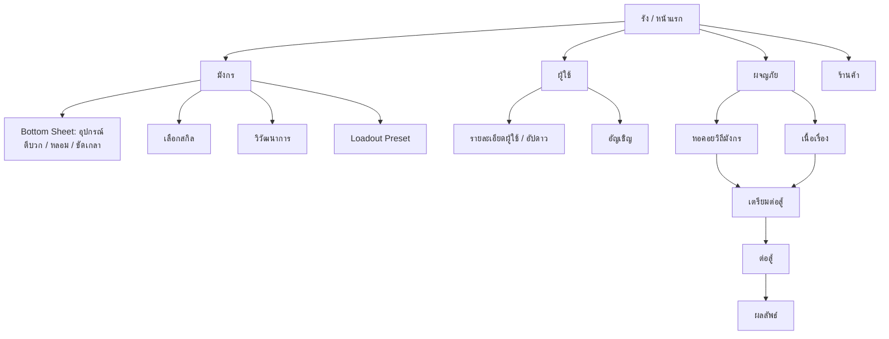

# Path to Dragon — การออกแบบ UI/UX แนวตั้ง (Portrait)

> กลับไปที่ [GDD.md](GDD.md) · Wireframe ด้านล่างใช้ป้ายภาษาอังกฤษเพื่อให้กล่องตรงแนวในฟอนต์ monospace — ข้อความจริงในเกมเป็นภาษาไทย/อังกฤษตาม Localization

---

## 1. หลักการออกแบบ

| หลักการ | รายละเอียด |
|---|---|
| **เล่นมือเดียว** | ปุ่มหลักทุกปุ่ม (ต่อสู้, อัปเกรด, ยืนยัน) อยู่ใน **Thumb Zone** = 40% ล่างของจอ |
| **ข้อมูลบน การกระทำล่าง** | ครึ่งบนแสดงมังกร/ข้อมูล ครึ่งล่างเป็นปุ่มและรายการ |
| **Bottom Sheet แทน Popup กลางจอ** | รายละเอียดอุปกรณ์ ผู้ใช้ ฯลฯ เลื่อนขึ้นจากด้านล่าง ปัดลงเพื่อปิด |
| **มังกรคือพระเอกของทุกหน้า** | หน้าหลัก หน้ามังกร และหน้าผู้ใช้ แสดงโมเดลมังกร (พร้อมผู้ใช้บนหลัง) เสมอ |
| **ตอบสนองทันที** | ทุกการอัปเกรดแสดงตัวเลขก่อน → หลัง (เช่น `ATK 1,250 → 1,310 ▲`) และ Affinity bar ขยับแบบมีแอนิเมชัน |
| **ไม่พึ่งสีอย่างเดียว** | ความหายาก/ธาตุ/Path มีไอคอนและรูปทรงกรอบกำกับเสมอ |

---

## 2. ข้อกำหนดหน้าจอ

| หัวข้อ | ค่า |
|---|---|
| Orientation | Portrait เท่านั้น (ปิด Landscape ทั้งสองทิศ) |
| ความละเอียดอ้างอิง | **1080 × 1920** (9:16) |
| รองรับสัดส่วน | 9:16 → 9:21 (มือถือจอยาว) และ 3:4 (แท็บเล็ต / iPad) |
| Safe Area | เคารพ notch / Dynamic Island / แถบท่าทางด้านล่าง ทุกหน้าจอ |
| ขนาดปุ่มต่ำสุด | 120 × 120 px ที่ความละเอียดอ้างอิง (≈ 48dp) ระยะห่างระหว่างปุ่ม ≥ 24 px |
| ขนาดตัวอักษร | เนื้อหา ≥ 36 px · ตัวเลขรอง ≥ 30 px · หัวข้อ 48–56 px (ภาษาไทยต้องเผื่อความสูงสระบน/ล่าง +20%) |

### 2.1 การจัดโซนหน้าจอ (ค่าที่ 1080 × 1920)

```
 y=0    +--------------------------------------+
        |  [ Safe Area Top ]                   |
        |  TOP BAR (140px)                     |  avatar ผู้ใช้, ทรัพยากร, การตั้งค่า
 y≈180  +--------------------------------------+
        |                                      |
        |  INFO / STAGE ZONE (~ 45%)           |  มังกร, ข้อมูล, สถานะ
        |                                      |
        +--------------------------------------+
        |                                      |
        |  ACTION ZONE (~ 35%)  <- Thumb Zone  |  ปุ่มหลัก, รายการ, แท็บย่อย
        |                                      |
 y≈1720 +--------------------------------------+
        |  BOTTOM NAV (200px)                  |
        |  [ Safe Area Bottom ]                |
 y=1920 +--------------------------------------+
```

### 2.2 แท็บเล็ตและจอพับ

- เมื่อสัดส่วนกว้างกว่า 9:16 (เช่น 3:4) → ใช้ **คอลัมน์กลางความกว้างคงที่** (1080 หน่วยอ้างอิง) และเติมด้านข้างด้วยภาพพื้นหลัง/ลวดลาย ไม่ยืด UI
- หน้าต่อสู้บนแท็บเล็ตขยายพื้นที่ฉากได้ แต่ปุ่มสกิลยังอยู่ในคอลัมน์กลาง
- รายละเอียดการตั้งค่า Canvas Scaler ดู [Unity-Tech.md §5](Unity-Tech.md#5-ui-แนวตั้งใน-unity)

---

## 3. โครงสร้างการนำทาง

### 3.1 Bottom Navigation (5 แท็บ)

```
+--------+-------+----------+-------+-------+
| DRAGON | RIDER | (NEST)   |  ADV  | SHOP  |
+--------+-------+----------+-------+-------+
                    ^ larger center button = home
```

| แท็บ | หน้าจอ | Badge แจ้งเตือน |
|---|---|---|
| มังกร | สถานะ, อุปกรณ์, สกิล, วิวัฒนาการ | อัปเกรดได้ / วิวัฒนาการได้ |
| ผู้ใช้ | รายชื่อผู้ใช้, อัปดาว, อัญเชิญ | อัปดาวได้ / อัญเชิญฟรี |
| รัง | หน้าแรก, รายได้ idle, ภารกิจ, จดหมาย | เก็บรายได้ได้ |
| ผจญภัย | เนื้อเรื่อง, **หอคอยวิถีมังกร**, อีเวนต์ | คบเพลิงเต็ม / หีบรายสัปดาห์ |
| ร้านค้า | ร้านเศษวิญญาณ, Battle Pass, แพ็ก | สินค้าใหม่ประจำสัปดาห์ |

### 3.2 แผนผังหน้าจอ



---

## 4. Wireframe หน้าหลัก

### 4.1 รัง (หน้าแรก)

```
+--------------------------------------+
| (Rider) Lv  | Gold 1.2M | Gem 3,450 [=]|
+--------------------------------------+
| [Mail] [Quest]            [Event]    |
|                                      |
|            .-~~~~-.                  |
|          (  DRAGON  )   <- แตะเพื่อ   |
|           \ +Rider /      ลูบ/ทักทาย  |
|            `------'                  |
|        "Ignis" Drake Lv 34           |
|        Power 18,420                  |
|                                      |
| +----------------------------------+ |
| | WEEKLY SPIRE: Roaring Volcano    | |
| | Floor 17/30   Reset in 3d 12h    | |
| | Torch 6/9          [ ENTER > ]   | |
| +----------------------------------+ |
| +--------------+ +-----------------+ |
| | NEST INCOME  | | NEXT GOAL       | |
| | 8h 20m [GET] | | Evolve: 6/8 Scl | |
| +--------------+ +-----------------+ |
+--------------------------------------+
| DRAGON | RIDER | (NEST) | ADV | SHOP |
+--------------------------------------+
```

- การ์ด **Weekly Spire** อยู่ใน Thumb Zone และแสดงเวลานับถอยหลังรีเซ็ตเสมอ
- **Next Goal** บอกเป้าหมายถัดไปที่ใกล้ที่สุด (เช่น เกล็ดโบราณที่ขาด) — ลดคำถาม "ต้องทำอะไรต่อ"

### 4.2 มังกร (สถานะ + อุปกรณ์)

```
+--------------------------------------+
| < Dragon            [Preset 1 v]     |
+--------------------------------------+
| [Heart]                      [Horn]  |
|                                      |
| [Claw]      ( DRAGON )       [Wing]  |
|             (  3D    )               |
| [Chest]     (rotate)         [Tail]  |
|                                      |
|  Fury    ######----  128  III        |
|  Bastion ##--------   22  I          |
|  Tempest #---------   13  -          |
|  Arcane  ----------    0  -          |
+--------------------------------------+
| [Stats] [Skills] [Evolve]            |
| HP 9,820  ATK 1,310  DEF 520         |
| SPD 118   CRIT 32% / 210%            |
|                                      |
| [ LEVEL UP ]          [ AUTO EQUIP ] |
+--------------------------------------+
| DRAGON | RIDER | NEST | ADV | SHOP   |
+--------------------------------------+
```

- ช่องอุปกรณ์ 6 ช่องล้อมรอบมังกร ช่องที่ยังไม่ปลดล็อกแสดงไอคอนกุญแจ + "ปลดล็อกที่ Stage X"
- **แถบ Affinity 4 Path** คือหัวใจของหน้านี้ — แสดงเส้นเกณฑ์ Tier (20 / 60 / 120 / 200) บนแถบ
- แตะแถบ Path → Bottom Sheet แสดง Trait และสกิลทั้งหมดของ Path นั้น (ล็อก/ปลดล็อก)
- AUTO EQUIP มีตัวเลือก "เน้น Path: [Fury v]" เพื่อให้การจัดอัตโนมัติยังเคารพทิศทางที่ผู้เล่นเลือก

### 4.3 Bottom Sheet: อุปกรณ์

```
+--------------------------------------+
|              ------  (drag handle)   |
| [ICON] Magma Scale Claw     +9       |
|        LEGENDARY   Fury +26          |
| ATK +323                             |
|  - CRIT DMG +9.2%                    |
|  - ATK% +5.1%                        |
|  - SPD +2                            |
|  - (unlocks at +12)                  |
| Set: Magma Scale (2/4) ATK +12%      |
+--------------------------------------+
| [Enhance] [Reforge] [Refine] [Salv.] |
|                                      |
|  +9 -> +10                           |
|  ATK 323 -> 340   Fury 26 -> 27      |
|  Cost: Forge 76 / Gold 15,200        |
|                                      |
|  [ ENHANCE ]  [ x5 ]  [ TO NEXT * ]  |
+--------------------------------------+
```

- `TO NEXT *` ตีบวกจนถึง milestone ถัดไป (+12) ในครั้งเดียว
- แท็บ **Reforge**: เลือก Path ปลายทาง แสดงตัวอย่าง Affinity ทั้ง 4 แถบก่อน/หลัง
- เปรียบเทียบกับชิ้นที่สวมอยู่: ปัดซ้าย/ขวาบน Bottom Sheet

### 4.4 ผู้ใช้ (รายชื่อ)

```
+--------------------------------------+
| < Riders       [Path v] [Rank v]     |
+--------------------------------------+
|  ACTIVE RIDER                        |
|  +------+  Kyren "Flame Blade"  SSR  |
|  |PORTR.|  ****-  (4/5)              |
|  |      |  ATK +18%  CRIT DMG +27%   |
|  +------+  Fury +21                  |
|  SUPPORT: [ + ] [ + ]  (Stage 4)     |
+--------------------------------------+
| +------+ +------+ +------+           |
| |Kyren | |Selena| |Brogan|           |
| |SSR **| |SSR * | |SSR***|           |
| +------+ +------+ +------+           |
| +------+ +------+ +------+           |
| | Lira | | Tim  | | Mina |           |
| |SR ***| |R *** | | R *  |           |
| +------+ +------+ +------+           |
|            ( scroll )                |
|                     [ SUMMON ]       |
+--------------------------------------+
| DRAGON | RIDER | NEST | ADV | SHOP   |
+--------------------------------------+
```

- การ์ดผู้ใช้มีจุดแจ้งเตือนเมื่อ **อัปดาวได้** และป้าย "แนะนำประจำสัปดาห์" สำหรับตัวที่ได้โบนัสในหอคอย
- แตะการ์ด → รายละเอียด · กดค้าง → **ขี่ทันที** (สลับผู้ใช้หลักใน 1 ท่าทาง)

### 4.5 รายละเอียดผู้ใช้ / อัปดาว

```
+--------------------------------------+
| <            Kyren          [RIDE]   |
+--------------------------------------+
|                                      |
|         ( Full-body art /            |
|           riding dragon )            |
|                                      |
|  SSR  Fury     ****-   4 / 5         |
+--------------------------------------+
| PACT BUFF            4*  ->  5*      |
|  ATK        +18.0%  ->  +22.0%       |
|  CRIT DMG   +27.0%  ->  +33.0%       |
|  Fury       +21     ->  +26          |
| STAR 3 TRAIT: Burn +10% (active)     |
| AWAKEN (5*): Command skill upgrade   |
+--------------------------------------+
|  Copies   [##-] 2/4   Seal [#] 1/2   |
|  Gold 200,000                        |
|            [ STAR UP ]               |
+--------------------------------------+
```

- ตารางบัพแสดง **ก่อน → หลัง** อัปดาวทุกครั้ง เพื่อให้ผู้เล่นเห็นคุณค่าของตัวซ้ำ
- อัปดาวสำเร็จ: แอนิเมชันดาวพุ่งเข้าใส่ผู้ใช้ แล้วมังกรคำรามรับบัพ (2–3 วินาที, ข้ามได้)

### 4.6 หอคอยวิถีมังกร (ดันเจี้ยนรายสัปดาห์)

```
+--------------------------------------+
| < Spire: Roaring Volcano   3d 12h    |
| [Fire+20%] [Thick Armor] [Rider+25%] |
| Featured: Kyren, Lira    Torch 6/9   |
+--------------------------------------+
|            [ 30  BOSS  ]  Ignar      |
|            [ 29 ]                    |
|            [ 28 ]                    |
|              :                       |
|            [ 20  GUARD ]             |
|              :                       |
|  >>>>>>>>  [ 17 ]  <<<<<<<< current  |
|            [ 16 ]  done   [SWEEP]    |
|            [ 15 ]  done   [SWEEP]    |
|              ( scroll up )           |
+--------------------------------------+
| Floor 17  Rec. Power 19,000          |
| Enemy: Fire  -> use WATER heart      |
| Rewards: Forge 44, Gear(Epic 55%)    |
|  [ PRESET v ]        [ CHALLENGE ]   |
+--------------------------------------+
```

- หอคอยเลื่อน **จากล่างขึ้นบน** — ผู้เล่นรู้สึกว่ากำลัง "ไต่" ขึ้นไป
- แถบ Affix อยู่ด้านบนสุด แตะเพื่อดูคำอธิบาย
- คำแนะนำอัตโนมัติ: "ศัตรูธาตุไฟ → แนะนำแก่นหัวใจธาตุน้ำ" + ปุ่มสลับ Preset ข้างปุ่มท้าสู้
- **SWEEP ALL** (กวาดหลายชั้นทีเดียว) ปลดล็อกเมื่อเคลียร์ชั้น 30 ครั้งแรก

### 4.7 หน้าต่อสู้

```
+--------------------------------------+
| Floor 17   01:12   [x2] [AUTO] [||]  |
+--------------------------------------+
|   [Enemy]   [ELITE]    [Enemy]       |
|   ====      ======     ====          |
|                                      |
|          ! warning area !            |
|                                      |
|                                      |
|            ( DRAGON )                |
|            ( +Rider )                |
|   HP ######################--  92%   |
+--------------------------------------+
|                                      |
|  [Skill1] [Skill2] [Skill3] (CMD)    |
|    3s       ok       8s     ##--     |
|                                      |
|  <<<  swipe left/right to DODGE  >>> |
+--------------------------------------+
```

- ไม่มี Bottom Nav ระหว่างต่อสู้ — พื้นที่ล่างทั้งหมดเป็นปุ่มสกิล
- ปุ่ม **Command (CMD)** ของผู้ใช้เป็นวงกลมใหญ่กว่า เรืองแสงเมื่อเกจเต็ม
- **หลบ:** ปัดซ้าย/ขวาที่ส่วนล่างของจอ เมื่อเห็นพื้นที่เตือนสีแดง (ระยะเตือน ≥ 0.8 วินาที)
- หยุดชั่วคราว (||) เปิดเมนู: ออก / ตั้งค่า / ดูบัพและ Affix

### 4.8 ผลลัพธ์การต่อสู้

```
+--------------------------------------+
|            VICTORY!  Floor 17        |
|            *  *  *  (clear time)     |
+--------------------------------------+
|  [Gear] [Forge x44] [Gold x5.4K]     |
|  [Essence x8] [Crystal x5]           |
+--------------------------------------+
|  Dragon EXP ########--  +1,240       |
|  Fury Affinity unchanged (128)       |
+--------------------------------------+
| [ UPGRADE GEAR ]       [ NEXT FLOOR ]|
+--------------------------------------+
```

- กรณีแพ้: แสดง **"ทำไมแพ้"** 1 บรรทัด (เช่น "ดาเมจไม่พอก่อนบอสคลั่ง — ลองเพิ่ม Fury") + ปุ่มลัดไปอัปเกรด

---

## 5. ท่าทางสัมผัส (Gestures)

| ท่าทาง | การทำงาน |
|---|---|
| แตะ | เลือก / ยืนยัน |
| กดค้าง (0.4 วินาที) | ดู tooltip ของไอคอน ค่าพลัง Affix · บนการ์ดผู้ใช้ = ขี่ทันที |
| ปัดลงบน Bottom Sheet | ปิด |
| ปัดซ้าย/ขวาบนรายละเอียด | สลับไปผู้ใช้/อุปกรณ์ชิ้นถัดไป |
| ลากบนโมเดลมังกร | หมุนมังกร |
| ปัดซ้าย/ขวาในการต่อสู้ | หลบ |
| ปุ่ม Back (Android) | ปิด Sheet/Popup บนสุด → ย้อนหน้า → ถามก่อนออกเกม |

---

## 6. ระบบภาพ (Visual Language)

| องค์ประกอบ | ข้อกำหนด |
|---|---|
| ความหายาก | ขาว / เขียว / ฟ้า / ม่วง / ส้ม / แดง + จำนวนมุมกรอบที่ต่างกัน (0–5 มุมประดับ) |
| Path | Fury 🔥 แดง · Bastion 🛡️ น้ำตาลทอง · Tempest 🌪️ เขียวมิ้นต์ · Arcane ✨ ม่วงคราม — ไอคอนรูปทรงต่างกันชัดเจน |
| ธาตุ | ไฟ / น้ำ / ลม / ดิน / แสง / มืด — ไอคอนเฉพาะ ใช้คู่กับตัวอักษรย่อเสมอ |
| ตัวเลขเพิ่ม/ลด | ▲ เขียว / ▼ แดง พร้อมสัญลักษณ์ ไม่ใช้สีอย่างเดียว |
| ฟอนต์ | ไทย: ฟอนต์ที่รองรับการวางตำแหน่งสระ/วรรณยุกต์ถูกต้อง (เช่น ตระกูล Noto Sans Thai / IBM Plex Sans Thai) · อังกฤษ/ตัวเลข: ฟอนต์หัวข้อสไตล์แฟนตาซี + ฟอนต์ตัวเลขอ่านง่าย |

---

## 7. การเข้าถึง (Accessibility)

- โหมดตาบอดสี 3 แบบ (Protanopia / Deuteranopia / Tritanopia) ปรับสีพื้นที่เตือนในการต่อสู้
- ปรับขนาดตัวอักษร 3 ระดับ (100% / 115% / 130%) — Layout ต้องไม่ตัดข้อความ
- ปิดการสั่น / ลดเอฟเฟกต์กระพริบ / ลดการเคลื่อนไหวกล้อง
- โหมด "ใช้มือซ้าย": สลับฝั่งปุ่ม Command และปุ่ม Auto
