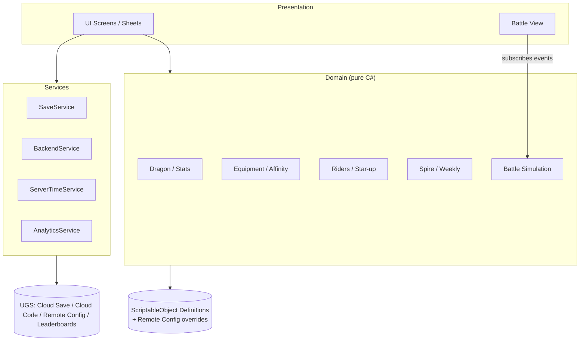

# Path to Dragon — แนวทางเทคนิคบน Unity

> กลับไปที่ [GDD.md](GDD.md) · โค้ดในเอกสารนี้เป็นตัวอย่างโครงสร้าง (reference) สำหรับเริ่มโปรเจกต์

---

## 1. Tech Stack

| หมวด | ตัวเลือก | เหตุผล |
|---|---|---|
| Engine | **Unity 6 LTS** (6000.x) | LTS รองรับยาว เหมาะกับเกม live service |
| Render | URP (Mobile profile) | ประสิทธิภาพดีบนมือถือ + Shader Graph สำหรับเอฟเฟกต์ธาตุ/รูน |
| UI | uGUI + TextMeshPro (หน้าจอเกม) | เครื่องมือ/แอนิเมชันพร้อมใช้ — พิจารณา UI Toolkit สำหรับหน้าจอที่เป็นรายการยาว ๆ |
| Input | Input System (Enhanced Touch) | รองรับท่าทางปัด/กดค้าง |
| Assets | Addressables | โหลดโมเดลมังกรแต่ละ Stage และธีมหอคอยแบบแยกส่วน ลดขนาดแอปเริ่มต้น |
| Localization | Unity Localization | ไทย / อังกฤษ (+ ภาษา SEA ภายหลัง) |
| Tween | DOTween หรือ PrimeTween | แอนิเมชัน UI |
| Async | UniTask หรือ `Awaitable` ของ Unity 6 | การโหลดและเรียก Backend |
| Backend | **Unity Gaming Services** (Authentication, Cloud Save, Cloud Code C#, Remote Config, Leaderboards, Analytics) | ใช้ C# ร่วมกันระหว่าง client และ Cloud Code ได้ — ทางเลือก: PlayFab, Firebase, Nakama |
| IAP | Unity IAP | — |

---

## 2. โครงสร้างโปรเจกต์

```
Assets/
└── _Project/
    ├── Art/                  # โมเดล, เท็กซ์เจอร์, VFX แยกตาม Dragon/Riders/Environment/UI
    ├── Audio/
    ├── Data/                 # ScriptableObject assets (definition ทั้งหมด)
    │   ├── Dragon/           #   DragonDefinition, StageDefinition
    │   ├── Equipment/        #   EquipmentDefinition, SetDefinition
    │   ├── Riders/           #   RiderDefinition, CommandSkillDefinition
    │   ├── Paths/            #   PathDefinition, TraitDefinition, ResonanceDefinition
    │   ├── Skills/
    │   └── Spire/            #   SpireThemeDefinition, AffixDefinition, BossDefinition
    ├── Prefabs/
    ├── Scenes/
    │   ├── Boot.unity        # init services, login, ดาวน์โหลด Addressables
    │   ├── Main.unity        # UI หลัก (คงอยู่ตลอด)
    │   └── Battle.unity      # โหลดแบบ Additive
    ├── Scripts/
    │   ├── Domain/           # กฎเกม C# ล้วน (ไม่พึ่ง MonoBehaviour) → ทดสอบง่าย ใช้ซ้ำใน Cloud Code
    │   │   ├── Stats/
    │   │   ├── Dragon/
    │   │   ├── Equipment/
    │   │   ├── Riders/
    │   │   ├── Paths/
    │   │   ├── Spire/
    │   │   └── Battle/       # battle simulation แบบ deterministic
    │   ├── Data/             # ScriptableObject classes
    │   ├── Services/         # Save, Backend, Time, Analytics, IAP, Audio
    │   ├── Presentation/
    │   │   ├── UI/           # Screens, Sheets, Popups, Widgets, SafeArea
    │   │   └── Battle/       # View ของ battle (แอนิเมชัน, VFX) ฟัง event จาก simulation
    │   └── Bootstrap/
    └── Tests/
        ├── EditMode/         # ทดสอบ Domain rules
        └── PlayMode/
```

แยก `Domain` เป็น **Assembly Definition** ของตัวเอง (`P2D.Domain`, ไม่อ้างอิง `UnityEngine` ถ้าเป็นไปได้) เพื่อให้คอมไพล์ไวและนำไปใช้ใน Cloud Code C# module ได้

---

## 3. สถาปัตยกรรม



**หลักการ**
- **Definition (ข้อมูลคงที่)** = ScriptableObject / Remote Config · **State (ข้อมูลผู้เล่น)** = คลาส C# ที่ serialize เป็น JSON
- Domain ไม่รู้จัก UI — UI เรียกใช้ Domain และฟัง event (`OnDragonChanged`, `OnAffinityChanged`)
- **Battle simulation แยกจาก View**: เดินด้วย fixed tick (เช่น 30 tick/วินาที) + seeded RNG → ผลลัพธ์ทำซ้ำได้ ใช้ตรวจสอบฝั่งเซิร์ฟเวอร์สำหรับชั้นอนันต์/Leaderboard และใช้ทำ "กวาดชั้น" แบบไม่ต้องเรนเดอร์
- การกระทำที่เกี่ยวกับเศรษฐกิจ (อัญเชิญ, รับรางวัล, ตีบวก, อัปดาว, รีเซ็ตรายสัปดาห์) ทำผ่าน **Cloud Code (server-authoritative)** — client แสดงผลแบบ optimistic แล้วยืนยันกับผลจากเซิร์ฟเวอร์

### 3.1 ชั้นของ UI

| Layer | ใช้กับ | พฤติกรรม |
|---|---|---|
| Screen | หน้าหลักของแต่ละแท็บ | สลับแทนกัน มี stack สำหรับปุ่ม Back |
| Sheet | Bottom Sheet รายละเอียด | ซ้อนบน Screen ปัดลงเพื่อปิด |
| Popup | ยืนยัน / รางวัล | Modal กลางจอ (ใช้น้อยที่สุด) |
| Overlay | Toast, Loading, Tutorial pointer | อยู่บนสุดเสมอ |

---

## 4. Data Model และตัวอย่างโค้ด

### 4.1 Enum และโครงสร้างพื้นฐาน

```csharp
namespace P2D.Domain
{
    public enum StatType { HP, ATK, DEF, SPD, CritRate, CritDmg, ElementDmg, SkillHaste, Resist }
    public enum ModType { Flat, Percent }
    public enum GrowthPath { Fury, Bastion, Tempest, Arcane }
    public enum Element { Fire, Water, Wind, Earth, Light, Dark }
    public enum Rarity { Common, Uncommon, Rare, Epic, Legendary, Mythic }
    public enum RiderRank { R, SR, SSR, UR }
    public enum EquipSlot { HeartCore, Claw, Chest, Horn, Wing, Tail }

    [System.Serializable]
    public struct StatModifier
    {
        public StatType stat;
        public ModType type;
        public float value;   // Percent เก็บเป็นทศนิยม: 0.12 = 12%
    }
}
```

### 4.2 Definition ของผู้ใช้ (ScriptableObject)

```csharp
using P2D.Domain;
using UnityEngine;

[CreateAssetMenu(menuName = "P2D/Rider Definition")]
public sealed class RiderDefinition : ScriptableObject
{
    public string id;
    public RiderRank rank;
    public bool hasPath;                     // R ไม่มี Path
    public GrowthPath path;
    public int baseAffinity;                 // SR 6 / SSR 12 / UR 15
    public StatModifier[] pactBuffs;         // ค่า ณ 1★
    public StatModifier[] star3Trait;        // ปลดล็อกที่ 3★
    public CommandSkillDefinition commandSkill; // null สำหรับ R/SR
}
```

### 4.3 State ของผู้เล่น

```csharp
[System.Serializable]
public sealed class RiderState
{
    public string riderId;
    public int star = 1;
    public int copies;          // ตัวซ้ำที่ยังไม่ได้ใช้
}

[System.Serializable]
public sealed class EquipmentState
{
    public string uid;          // id เฉพาะชิ้น
    public string definitionId;
    public Rarity rarity;
    public GrowthPath path;     // เปลี่ยนได้ด้วย Path Reforge
    public int enhance;         // 0–15
    public StatModifier main;
    public StatModifier[] subs;
}

[System.Serializable]
public sealed class DragonState
{
    public string name;
    public int level = 1;
    public int stage = 1;
    public long exp;
    public string[] equipped = new string[6];   // index = (int)EquipSlot
    public string[] skillIds = new string[3];
    public string mainRiderId;
    public string[] supportRiderIds = new string[2];
}
```

### 4.4 กฎของผู้ใช้ (ดาว / บัพ)

```csharp
public static class RiderRules
{
    public const int MaxStar = 5;
    public const float SupportRatio = 0.30f;

    // index = star - 1 · เก็บเป็นเปอร์เซ็นต์จำนวนเต็มเพื่อเลี่ยง floating error ตอนปัดเศษ
    static readonly int[] StarMultPct = { 100, 125, 150, 180, 220 };
    static readonly int[] CopiesToReach = { 0, 1, 2, 3, 4 };

    public static float StarMultiplier(int star) => StarMultPct[star - 1] / 100f;
    public static int CopiesNeeded(int targetStar) => CopiesToReach[targetStar - 1];
    public static int MaxSeals(int targetStar) => CopiesNeeded(targetStar) / 2;

    public static int Affinity(RiderDefinition def, RiderState state) =>
        def.hasPath ? def.baseAffinity * StarMultPct[state.star - 1] / 100 : 0;

    public static bool CanStarUp(RiderState state, int sealsOwned)
    {
        if (state.star >= MaxStar) return false;
        int target = state.star + 1;
        int usableSeals = System.Math.Min(sealsOwned, MaxSeals(target));
        return state.copies + usableSeals >= CopiesNeeded(target);
    }

    public static IEnumerable<StatModifier> Buffs(RiderDefinition def, RiderState state, float ratio = 1f)
    {
        float mult = StarMultiplier(state.star) * ratio;
        foreach (var m in def.pactBuffs)
            yield return new StatModifier { stat = m.stat, type = m.type, value = m.value * mult };
        if (state.star >= 3)
            foreach (var m in def.star3Trait)
                yield return new StatModifier { stat = m.stat, type = m.type, value = m.value * mult };
    }
}
```

### 4.5 Affinity และ Tier

```csharp
public static class AffinityRules
{
    public static readonly int[] TierThresholds = { 20, 60, 120, 200 };
    static readonly int[] RarityBase = { 4, 6, 9, 13, 18, 25 };   // index = (int)Rarity

    public static int ForEquipment(Rarity rarity, int enhance) =>
        RarityBase[(int)rarity] * (100 + 5 * enhance) / 100;

    public static int Tier(int affinity)
    {
        int tier = 0;
        foreach (int t in TierThresholds)
            if (affinity >= t) tier++;
        return tier;
    }

    public static Dictionary<GrowthPath, int> Compute(
        IEnumerable<EquipmentState> equipped, RiderDefinition mainRider, RiderState mainRiderState)
    {
        var result = new Dictionary<GrowthPath, int>
        {
            [GrowthPath.Fury] = 0, [GrowthPath.Bastion] = 0,
            [GrowthPath.Tempest] = 0, [GrowthPath.Arcane] = 0,
        };
        foreach (var e in equipped)
            result[e.path] += ForEquipment(e.rarity, e.enhance);
        if (mainRider != null && mainRider.hasPath)
            result[mainRider.path] += RiderRules.Affinity(mainRider, mainRiderState);
        return result;
    }
}
```

### 4.6 การรวมค่าพลัง

```csharp
public sealed class StatSheet
{
    readonly float[] baseValues = new float[9];
    readonly float[] flat = new float[9];
    readonly float[] percent = new float[9];

    public void SetBase(StatType s, float v) => baseValues[(int)s] = v;

    public void Add(StatModifier m)
    {
        if (m.type == ModType.Flat) flat[(int)m.stat] += m.value;
        else percent[(int)m.stat] += m.value;
    }

    public void AddRange(IEnumerable<StatModifier> mods)
    {
        foreach (var m in mods) Add(m);
    }

    // Final = (Base + ΣFlat) × (1 + ΣPercent)  — ดู Balance.md §2.3
    public float Get(StatType s) => (baseValues[(int)s] + flat[(int)s]) * (1f + percent[(int)s]);
}
```

ลำดับการคำนวณ: ค่าพื้นฐานมังกร (Level × Stage) → อุปกรณ์ (main + sub + set) → ผู้ใช้หลัก (×1.0) → ผู้ใช้สนับสนุน (×0.3) → Path Trait ตาม Tier → (ในการต่อสู้) Affix เป็นตัวคูณแยก
**คำนวณใหม่เฉพาะเมื่อมีการเปลี่ยนแปลง** (dirty flag) ไม่คำนวณทุกเฟรม

### 4.7 ปฏิทินรายสัปดาห์

```csharp
public static class WeeklyCalendar
{
    // จันทร์ 05:00 ICT = อาทิตย์ 22:00 UTC (4 ม.ค. 2026 เป็นวันอาทิตย์)
    static readonly DateTime Epoch = new DateTime(2026, 1, 4, 22, 0, 0, DateTimeKind.Utc);

    public static int WeekIndex(DateTime utcNow) =>
        (int)Math.Floor((utcNow - Epoch).TotalDays / 7.0);

    public static DateTime NextResetUtc(DateTime utcNow) =>
        Epoch.AddDays(7 * (WeekIndex(utcNow) + 1));

    // ใช้เป็นค่า fallback เท่านั้น — ธีมจริงมาจาก Remote Config ตาม WeekIndex
    public static int FallbackThemeIndex(int weekIndex, int themeCount) =>
        ((weekIndex % themeCount) + themeCount) % themeCount;
}
```

> **ห้ามใช้เวลาเครื่องผู้เล่น** ตัดสินการรีเซ็ต — `ServerTimeService` ดึงเวลาจากเซิร์ฟเวอร์ตอนล็อกอินแล้วนับต่อด้วย `Time.realtimeSinceStartupAsDouble` การรีเซ็ตจริง (มอบหีบรายสัปดาห์, ล้างความคืบหน้า, คำนวณชั้นเริ่มต้นแบบ catch-up) ทำใน Cloud Code เมื่อผู้เล่นเข้าเกมครั้งแรกของสัปดาห์ใหม่

---

## 5. UI แนวตั้งใน Unity

### 5.1 Player Settings

- `Resolution and Presentation → Default Orientation = Portrait`
- ปิด `Landscape Left / Landscape Right` และ `Portrait Upside Down`
- iOS: `Requires Fullscreen` เปิด · Android: ตั้ง `Render outside safe area` = เปิด แล้วจัดการ Safe Area เอง

### 5.2 Canvas Scaler ที่ปรับตามสัดส่วนจอ

ความละเอียดอ้างอิง 1080 × 1920
- จอที่ **ยาวกว่า** 9:16 (มือถือส่วนใหญ่) → Match **Width** (ได้พื้นที่แนวตั้งเพิ่ม)
- จอที่ **กว้างกว่า** 9:16 (แท็บเล็ต) → Match **Height** (เนื้อหาไม่ล้นแนวตั้ง แล้วใช้คอลัมน์กลาง)

```csharp
[RequireComponent(typeof(CanvasScaler))]
public sealed class PortraitCanvasScaler : MonoBehaviour
{
    const float ReferenceAspect = 1080f / 1920f;

    CanvasScaler scaler;
    Vector2Int lastScreen;

    void Awake()
    {
        scaler = GetComponent<CanvasScaler>();
        scaler.uiScaleMode = CanvasScaler.ScaleMode.ScaleWithScreenSize;
        scaler.referenceResolution = new Vector2(1080, 1920);
        Apply();
    }

    void Update()
    {
        if (Screen.width != lastScreen.x || Screen.height != lastScreen.y) Apply();
    }

    void Apply()
    {
        lastScreen = new Vector2Int(Screen.width, Screen.height);
        float aspect = (float)Screen.width / Screen.height;
        scaler.matchWidthOrHeight = aspect > ReferenceAspect ? 1f : 0f;
    }
}
```

บนแท็บเล็ต ให้ root ของเนื้อหาเป็น **ContentColumn** กว้างคงที่ 1080 หน่วย จัดกึ่งกลาง และวางภาพพื้นหลังเต็มจอไว้ด้านหลัง

### 5.3 Safe Area

```csharp
[RequireComponent(typeof(RectTransform))]
public sealed class SafeAreaFitter : MonoBehaviour
{
    RectTransform rect;
    Rect lastSafeArea;
    Vector2Int lastScreen;

    void Awake()
    {
        rect = (RectTransform)transform;
        Apply();
    }

    void Update()
    {
        if (Screen.safeArea != lastSafeArea || Screen.width != lastScreen.x || Screen.height != lastScreen.y)
            Apply();
    }

    void Apply()
    {
        lastSafeArea = Screen.safeArea;
        lastScreen = new Vector2Int(Screen.width, Screen.height);

        Vector2 min = lastSafeArea.position;
        Vector2 max = lastSafeArea.position + lastSafeArea.size;
        min.x /= Screen.width;  min.y /= Screen.height;
        max.x /= Screen.width;  max.y /= Screen.height;

        rect.anchorMin = min;
        rect.anchorMax = max;
        rect.offsetMin = rect.offsetMax = Vector2.zero;
    }
}
```

- พื้นหลังและแถบสีของ Top Bar / Bottom Nav ยืดเต็มจอ (นอก Safe Area) ส่วนปุ่มและข้อความอยู่ใน Safe Area
- ใช้ **Device Simulator** ของ Unity ทดสอบ: iPhone SE (จอเล็ก), iPhone Pro Max (Dynamic Island), Android จอยาว 20:9, iPad, จอพับ

### 5.4 ประสิทธิภาพ UI

- แยก Canvas: ส่วนคงที่ (กรอบ, พื้นหลัง) / ส่วนเปลี่ยนบ่อย (ตัวเลข, ตัวจับเวลา) เพื่อลด rebuild
- รายการยาว (คลังอุปกรณ์หลายร้อยชิ้น, รายชื่อผู้ใช้) ใช้ **virtualized scroll / object pool**
- Sprite Atlas แยกตามหน้าจอ · ปิด Raycast Target บน Graphic ที่ไม่ต้องรับการแตะ

---

## 6. งานอาร์ตมังกรแบบ Modular

เป้าหมาย: 5 Stage × 4 Path = 20 รูปลักษณ์ โดยไม่ต้องสร้าง 20 โมเดลแยกกัน

| ชั้น | วิธีทำ |
|---|---|
| โครงกระดูก (Rig) | 1 rig ต่อ Stage (รวม 5 rig) ใช้ชุดแอนิเมชันร่วมกันภายใน Stage |
| ชิ้นส่วนตาม Path | Mesh แยก: เขา, หนามหลัง, ปีก, ปลายหาง — สลับตาม Dominant Path |
| วัสดุ | Shader Graph เดียว รับพารามิเตอร์ สีเกล็ด / สี Emission ตามธาตุ / ความเข้มลายรูน (Arcane) / ความหนาเกล็ด (Bastion) |
| อุปกรณ์ที่มองเห็นได้ (stretch goal) | Socket บน rig สำหรับเกราะอก, ปลอกเขา, เกราะปีก |
| ผู้ใช้บนหลัง | Socket "Saddle" + ท่านั่งร่วมกัน สลับเฉพาะ mesh ผู้ใช้ |
| โหลด | Addressables group ต่อ Stage — โหลดเฉพาะ Stage ปัจจุบัน + ถัดไป (สำหรับคัตซีนวิวัฒนาการ) |

---

## 7. Backend และการกันโกง

| ฟีเจอร์ | บริการ (UGS) | หมายเหตุ |
|---|---|---|
| บัญชีผู้เล่น | Authentication | เริ่มแบบ Anonymous แล้วผูก Google Play Games / Apple / อีเมล |
| ข้อมูลผู้เล่น | Cloud Save | JSON ของ `DragonState`, `EquipmentState[]`, `RiderState[]`, `WalletState`, `SpireProgress` |
| การกระทำที่ต้องเชื่อถือได้ | Cloud Code (C# module) | อัญเชิญ, รับรางวัลชั้น/หีบ, ตีบวก, อัปดาว, วิวัฒนาการ, รีเซ็ตรายสัปดาห์ — ใช้ `P2D.Domain` ชุดเดียวกับ client |
| ธีมรายสัปดาห์ / สมดุล | Remote Config | ธีม บอส Affix ผู้ใช้แนะนำ ต่อ `WeekIndex` + ค่าสมดุลที่ override ได้ |
| ชั้นอนันต์ | Leaderboards | Reset รายสัปดาห์ · ส่งคะแนนผ่าน Cloud Code หลังตรวจ replay (seed + input log) |
| วิเคราะห์ | Analytics | ดู §9 |

**ข้อมูลที่ client เป็นผู้ตัดสินได้:** การตั้งค่า, Preset, การสลับผู้ใช้/อุปกรณ์ (ตรวจซ้ำบนเซิร์ฟเวอร์ตอนเริ่มต่อสู้)
**ข้อมูลที่เซิร์ฟเวอร์เท่านั้นตัดสิน:** สกุลเงินทุกชนิด, ผลสุ่ม (อัญเชิญ/ดรอป/sub-stat), ความคืบหน้าหอคอย, การรีเซ็ตรายสัปดาห์

---

## 8. ภาษาไทยและ Localization

ภาษาไทยมีสระบน/ล่างและวรรณยุกต์ที่ต้องวางตำแหน่งตามบริบท (เช่น `ปี่` `ที่` `ญู`) — **TextMeshPro ไม่ได้ทำ OpenType shaping เต็มรูปแบบสำหรับภาษาไทย** จึงอาจเห็นวรรณยุกต์ซ้อนสระหรือชนหางพยัญชนะ

**สถานะตอนนี้ (greybox, uGUI `Text`):** ฟอนต์ **Noto Sans Thai** (ไฟล์ variable จาก Google Fonts, SIL OFL — ไลเซนส์อยู่ข้างไฟล์ใน `NotoSansThai-OFL.txt`) อยู่ที่ `Assets/_Project/Art/Fonts/Resources/NotoSansThai.ttf` ฟอนต์นี้มีทั้งอักษรไทยและละติน (ASCII, `· — × …`) จึงใช้เป็นฟอนต์หลักฟอนต์เดียว
- `UiKit.Font` โหลดด้วย `Resources.Load<Font>("NotoSansThai")` (ใช้ได้ทั้งใน editor และ player build) ถ้าไม่พบจะใช้ `LegacyRuntime.ttf` แทน — ทุก `Text` ที่สร้างผ่าน `UiKit.Label` และ HUD ของฉากต่อสู้ใช้ฟอนต์นี้
- legacy `Text` ไม่มี OpenType shaping (GSUB/GPOS) และ Noto Sans Thai ไม่มี glyph ชุด PUA ถ้าไม่แก้: วรรณยุกต์ทับสระบนจนมองไม่เห็น (`ที่`→`ที`), เครื่องหมายบนชนหาง `ป ฝ ฟ ฬ` และสระล่างจมในหาง `ญ ฐ ฎ ฏ`
- **แก้แล้วด้วย `ThaiMarkPositioner`** (`BaseMeshEffect` ที่ `UiKit.Label` และ HUD ต่อสู้ใส่ให้ทุก `Text`): หลัง `Text` สร้าง mesh จะขยับ quad ของเครื่องหมาย — (ก) เครื่องหมายบนตัวที่สองขึ้นไปในพยางค์ยกขึ้นเหนือตัวก่อนหน้า และวรรณยุกต์หน้า `ำ` ยกเหนือวงของ `ำ` (ข) เครื่องหมายบนของ `ป ฝ ฟ ฬ` เลื่อนซ้าย 0.12 em (ค) สระล่างที่ทับหางพยัญชนะเลื่อนลงใต้หาง ช่องว่างระหว่างเครื่องหมาย 0.04 em; ระยะคำนวณจากกรอบ quad จริงจึงไม่ผูกกับฟอนต์ (ยกเว้น 0.12 em)
- ข้อจำกัด: `ญ ฐ` ยังมีหาง (ฟอนต์จริงจะสลับเป็นรูปไม่มีหางผ่าน GSUB) — สระล่างจึงอยู่ใต้หางแทน; ถ้านับ quad ไม่ตรงกับตัวอักษร (เช่นใช้ tag `<quad>`) effect จะไม่ทำอะไร
- ทดสอบ: `ThaiFontTests` (PlayMode) ตรวจฟอนต์ การซ้อนวรรณยุกต์ `ที่` `น้ำ` `ปี่` สระล่าง `ญู` และ rich text; screenshot ตรวจแล้ว (`ที่ ปี่ ญู ฐุ น้ำ ฟื้น ผู้ ญี่ปุ่น ป่า ฎุ` วางถูกตำแหน่ง)

แนวทาง (ต้องทดสอบตั้งแต่สัปดาห์แรกของ Prototype):
1. ใช้ฟอนต์ไทยที่มี glyph ตำแหน่งสำรอง (เช่นชุด PUA แบบดั้งเดิม) ร่วมกับสคริปต์ปรับตำแหน่งสระ/วรรณยุกต์ก่อนส่งข้อความเข้า TMP (แนวทาง "Thai Font Adjuster" ที่ชุมชนนักพัฒนาไทยใช้กัน)
2. หรือใช้ **UI Toolkit กับ Advanced Text Generator** ของ Unity 6 (ใช้ shaping engine ที่รองรับ complex script) สำหรับหน้าจอที่มีข้อความยาว — ตรวจสอบสถานะรองรับในเวอร์ชัน Unity ที่เลือกใช้ก่อนตัดสินใจ
3. **การตัดคำ:** ภาษาไทยไม่มีช่องว่างระหว่างคำ — ใส่ zero-width space (U+200B) ระหว่างคำในไฟล์แปล (ทำอัตโนมัติด้วยเครื่องมือตัดคำ เช่น PyThaiNLP ในขั้นตอน export) เพื่อให้ขึ้นบรรทัดใหม่ถูกตำแหน่ง
4. เผื่อความสูงบรรทัด (line height) สำหรับภาษาไทยมากกว่าอังกฤษ ~20% และทดสอบข้อความยาวที่สุดในทั้งสองภาษา
5. ตัวเลขใช้เลขอารบิก, รูปแบบตัวเลข/วันที่ผ่าน Locale (เช่น `1,250` และการนับถอยหลัง `3 วัน 12 ชม.`)

---

## 9. Analytics Events (ขั้นต่ำ)

| Event | Parameters | ใช้ตอบคำถาม |
|---|---|---|
| `tutorial_step` | step_id | ผู้เล่นหลุดตรงไหนใน FTUE |
| `dragon_level_up` / `dragon_evolve` | level, stage | ความเร็วความคืบหน้าเทียบกับ [Balance.md §8](Balance.md#8-จังหวะความคืบหน้าเป้าหมาย-ผู้เล่นฟรี-เล่นวันละ-20-นาที) |
| `path_tier_reached` | path, tier, slot_count | ผู้เล่นเลือก "สุดทาง" หรือ "ไฮบริด" |
| `equip_enhance` / `equip_reforge` | rarity, slot, from, to, path | ศิลาตีเหล็กพอหรือไม่ · มีคนเปลี่ยนทิศทางบ่อยแค่ไหน |
| `rider_switch` / `rider_star_up` | rider_id, star | ผู้ใช้ตัวไหนถูกใช้/ไม่ถูกใช้ |
| `spire_floor_result` | week, bracket, floor, result, power, path, element, fail_reason | ความยากแต่ละชั้น · Affix ที่ทำให้แพ้ |
| `spire_weekly_summary` | week, max_floor, sweeps | การมีส่วนร่วมรายสัปดาห์ |
| `summon` | banner, count, results | ตรวจสอบอัตราและ pity |
| `iap_purchase` | sku, price | รายได้ |

---

## 10. การทดสอบและเป้าหมายประสิทธิภาพ

**การทดสอบ**
- EditMode tests สำหรับ `P2D.Domain`: Affinity/Tier, Star-up + ผนึกวิญญาณ, สูตรดาเมจ, `WeeklyCalendar` (ข้ามปี, ก่อน/หลังเวลารีเซ็ต 1 วินาที)
- **Balance Simulator** (Editor Window): จำลองผู้เล่นฟรีเล่นวันละ N นาทีเป็นเวลา X สัปดาห์ แล้วเทียบกับตารางเป้าหมายใน Balance.md
- Battle simulation determinism test: seed + input เดียวกันต้องได้ผลลัพธ์เหมือนกันทุกครั้ง (ทั้ง client และ Cloud Code)
- อุปกรณ์จริง: Android ระดับล่าง (RAM 3–4GB), Android กลาง, iPhone รุ่นเก่า/ใหม่, iPad

**เป้าหมายประสิทธิภาพ**

| ตัวชี้วัด | เป้าหมาย |
|---|---|
| FPS | 60 บนเครื่องระดับกลาง · 30 บนเครื่องระดับล่าง/โหมดประหยัดแบต |
| ขนาดแอปเริ่มต้น | ≤ 150 MB (ที่เหลือดาวน์โหลดผ่าน Addressables) |
| หน่วยความจำ | ≤ 1 GB บนเครื่องระดับล่าง |
| Draw calls (ต่อสู้) | ≤ 150 |
| เวลาเปิดแอปถึงหน้ารัง | ≤ 8 วินาที (โหลดครั้งที่สอง) |
